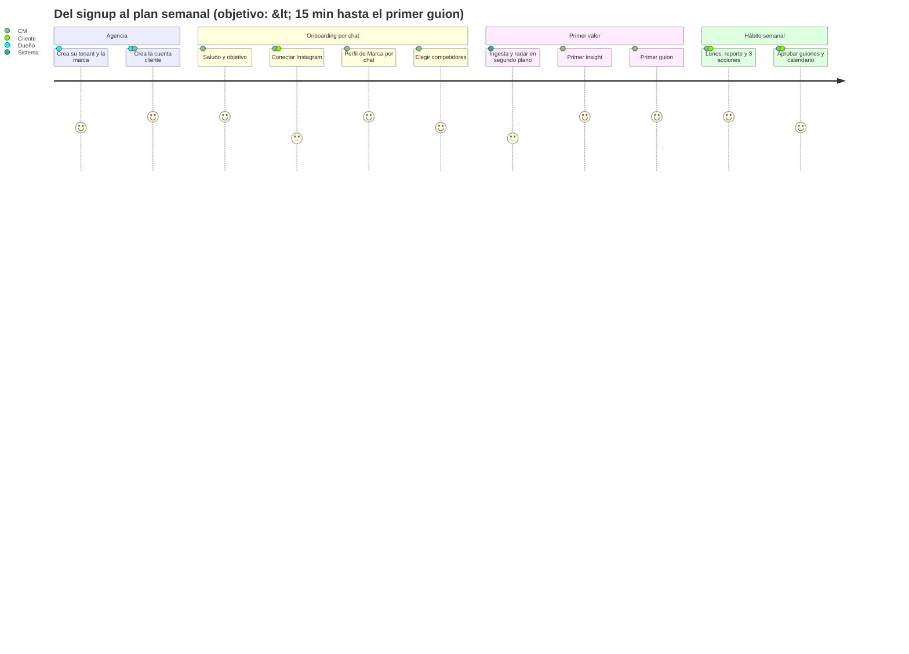
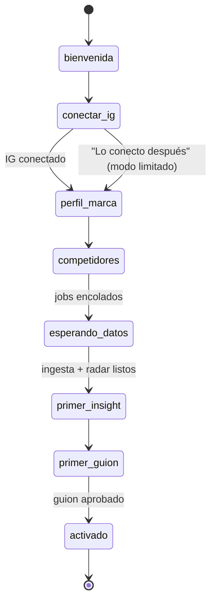
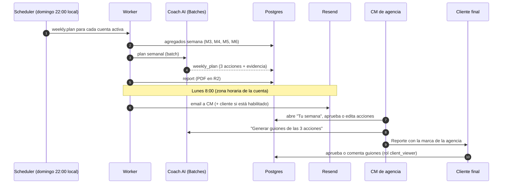

# Flujo guiado SIMPLE: el corazón de Jeder AI

> **Principio rector:** el usuario no "usa un dashboard": **conversa con un estratega** que ya miró sus datos y los de su competencia, y que le dice **qué hacer ahora**.
> Relacionados: [PRD](prd.md) · [Módulos](modulos.md) · [Prompt del Guía](../05-agentes-ai/prompts/guia.md) · [Arquitectura multiagente](../05-agentes-ai/arquitectura-multiagente.md) · [Métricas norte](metricas-norte.md)

---

## 1. Principios de diseño

| # | Principio | En la práctica |
|---|---|---|
| P1 | **Una acción recomendada por pantalla** | Cada pantalla tiene **un** botón primario (color de la marca). Lo demás es secundario o va en un menú "Más" |
| P2 | **El chat siempre sabe en qué paso estás** | El Guía lee el `onboarding_step` y el estado de la cuenta antes de responder; nunca pregunta algo que ya sabe |
| P3 | **Evidencia antes que opinión** | Toda recomendación muestra "por qué" con 1–3 referencias clickeables (post, competidor, anuncio) |
| P4 | **Botones, no tipeo** | Cada mensaje de la AI termina con 1–3 *quick replies*. El texto libre siempre está disponible, pero no es obligatorio |
| P5 | **Nunca un estado vacío mudo** | Si no hay datos, se explica por qué, cuánto falta y qué hacer mientras tanto |
| P6 | **Progreso visible** | Checklist de activación de 5 pasos siempre visible hasta completarlo |
| P7 | **Lenguaje del infoproductor** | "Hook", "Reel", "lanzamiento", "embudo de WhatsApp". Nada de "engagement rate normalizado" sin explicar |
| P8 | **Lo largo corre en segundo plano** | Ingesta, scraping y análisis de video son jobs; el chat avisa "te escribo cuando esté" y sigue |
| P9 | **Formulario de escape** | Todo lo que se pide por chat se puede completar o editar en un formulario |

### Anatomía de una pantalla

```
┌─────────────────────────────────────────────────────────────┐
│ [Logo agencia]  Cuenta: Caro Nutrición ▾        [Avatar]    │
├──────────────┬──────────────────────────────────────────────┤
│ ✓ Conectar IG│  TÍTULO: "Tu semana"                         │
│ ✓ Perfil     │                                              │
│ ● Competidor.│  Contenido principal (datos, tarjetas)       │
│ ○ 1er análisis                                              │
│ ○ 1er guion  │  ┌────────────────────────────────────────┐  │
│              │  │  ★ ACCIÓN RECOMENDADA (una sola)       │  │
│ Mi contenido │  │  [ Generar guion de la acción #1 ]     │  │
│ Competencia  │  └────────────────────────────────────────┘  │
│ Anuncios     │                                              │
│ Guiones      │                         ┌──────────────────┐ │
│ Calendario   │                         │ 💬 Chat con Guía │ │
│ Reportes     │                         └──────────────────┘ │
└──────────────┴──────────────────────────────────────────────┘
```

---

## 2. Journey completo: del signup al primer guion y el plan semanal



### Diagrama de estados del onboarding



`onboarding_step` se guarda en `client_accounts`. El Guía lo lee en cada turno.

---

### Paso 0: la agencia prepara el terreno (fuera del chat, 1 sola vez)

| Pantalla | Acción recomendada única |
|---|---|
| Signup agencia (email + nombre de agencia) | **Crear mi cuenta** |
| Marca (logo, color, nombre del producto) | **Guardar mi marca** (dominio custom: "más tarde", en Configuración) |
| Cartera vacía | **Agregar mi primer cliente** |
| Nueva cuenta cliente (nombre + zona horaria) | **Empezar onboarding con la AI** |

### Paso 1: bienvenida y objetivo

> **Guía:** ¡Hola, Lucía! Soy tu estratega de contenido para **Caro Nutrición**. En unos 10 minutos vamos a dejar todo listo para que el lunes tengas un plan semanal y tus primeros guiones.
> Primero, ¿cuál es el objetivo principal de Caro para los próximos 3 meses?
>
> `[Crecer seguidores]` `[Vender más el programa]` `[Preparar un lanzamiento]` `[Otro]`

> **Lucía:** Vender más el programa

> **Guía:** Perfecto, entonces vamos a priorizar contenido que genere **conversaciones y ventas**, no solo alcance. Ahora conectemos el Instagram de Caro para poder ver qué le está funcionando.
>
> `[Conectar Instagram]` `[Mandarle el link a Caro]` `[Lo conecto después]`

### Paso 2: conectar Instagram

- **`[Conectar Instagram]`** → OAuth de Meta → selector de página/IG → vuelve al chat.
- **`[Mandarle el link a Caro]`** → genera un link firmado (expira en 7 días) que la agencia envía por WhatsApp. El chat queda en "esperando conexión" y avisa por email cuando Caro conecta.
- **`[Lo conecto después]`** → modo limitado: se puede armar el perfil, sumar competidores (Business Discovery requiere un IG Business conectado ⚠️; si la agencia tiene su propio IG conectado se usa ese token, ver [ADR 0002](../04-arquitectura/adr/0002-multi-tenant-marca-blanca.md)) y espiar anuncios.

> **Guía (tras conectar):** ¡Listo! Conecté **@caro.nutri** (18.400 seguidores). Ya empecé a traer los últimos 90 días de publicaciones; tarda unos minutos y mientras tanto armamos el perfil.
>
> Contame en una frase: **¿qué vende Caro y a quién?**

**Errores típicos y respuesta del Guía:**

| Situación | Respuesta |
|---|---|
| IG es cuenta personal | "Tu cuenta es personal y Meta no deja leer sus métricas. Pasarla a Profesional tarda 1 minuto: [ver cómo]. ¿Te espero?" |
| IG sin página de FB vinculada | "Hace falta vincular el IG a una página de Facebook. [Guía de 3 pasos]" (ruta Instagram Login: Could, post-MVP) |
| Usuario cancela el OAuth | "No pasa nada. Podés conectarlo cuando quieras; mientras, sigamos con el perfil." |

### Paso 3: Perfil de Marca por chat

> **Lucía:** Vende un programa de 8 semanas para bajar de peso sin dietas extremas, para mujeres de 30 a 45 que ya probaron de todo. Cuesta USD 197 y se vende por WhatsApp.

> **Guía:** Buenísimo. Esto es lo que entendí:
>
> | Campo | Valor |
> |---|---|
> | Nicho | Nutrición / pérdida de peso para mujeres |
> | Oferta | Programa de 8 semanas · USD 197 · venta por WhatsApp |
> | Avatar | Mujer de 30–45, ya probó dietas, frustrada con el efecto rebote |
> | Promesa | Bajar de peso sin dietas extremas |
>
> `[Está bien]` `[Corregir algo]`
>
> Una más: ¿cómo habla Caro en sus videos?
> `[Cercana y con humor]` `[Profesional y técnica]` `[Motivacional]` `[Te paso un video y lo detectás vos]`

- Si elige **"Te paso un video…"**, el Guía delega en el Analista de Contenido y propone tono y palabras típicas a partir del transcript.
- El Perfil de Marca se guarda en `brand_profiles` (versión 1) y queda editable en un formulario.

### Paso 4: competidores

> **Guía:** ¿A quiénes mira Caro como referentes o competencia? Pasame entre 3 y 10 @ de Instagram. Si no sabés, te sugiero algunos.
>
> `[Sugerime]` `[Los escribo]`

> **Lucía:** @nutri.sofi @lafit.mama @dra.comeconciencia

> **Guía:** Revisé los tres:
> - ✅ **@nutri.sofi**: 120k seguidores, publica ~5 Reels por semana
> - ✅ **@lafit.mama**: 45k seguidores
> - ⚠️ **@dra.comeconciencia** es una cuenta personal, así que Meta no muestra sus datos. ¿La reemplazamos?
>
> Además, ¿querés que espíe los **anuncios** que están pautando? Es ideal para ver qué ofertas y ángulos usan para vender.
> `[Sí, espiar anuncios]` `[Ahora no]`

Al confirmar se encolan: `ingest.own.initial`, `competitors.snapshot`, `ads.scrape` (por anunciante) y `video.analyze.top` (top 5 propios + top 5 de competidores).

### Paso 5: esperando datos (estado vacío activo)

> **Guía:** Estoy analizando **@caro.nutri** y sus competidores. Esto tarda entre 3 y 8 minutos.
> Mientras tanto, ¿querés que te muestre los 3 Reels de la competencia que mejor funcionaron este mes? Ya los tengo.
> `[Mostrame]` `[Avisame cuando esté todo]`

Barra de progreso con pasos reales (vía eventos del worker): ✓ 87 publicaciones · ✓ 2 competidores · ⏳ analizando 10 videos (4/10) · ⏳ anuncios.

### Paso 6: primer insight ("momento ajá")

> **Guía:** Listo. Esto es lo más importante que encontré:
>
> 1. **Tus Reels de "mitos" rinden 2,4× más** que tu promedio de alcance (ej.: [Reel del 12/10](#)). Pero publicaste solo 2 en los últimos 60 días.
> 2. **@nutri.sofi** abre casi todos sus videos con una **pregunta que incomoda** ("¿Por qué comés sano y no bajás?"). Sus 5 mejores Reels usan ese hook.
> 3. **@lafit.mama** tiene un anuncio activo hace **47 días** que manda a WhatsApp con la promesa "plan de 21 días". Si sigue activo tanto tiempo, probablemente le funciona.
>
> Te propongo arrancar con un guion que combine 1 y 2: **un mito con hook de pregunta incómoda.**
> `[Escribir ese guion]` `[Quiero otra idea]`

### Paso 7: primer guion

> **Guía:** Le pido al Guionista… ✍️

*(streaming; el guion aparece como tarjeta estructurada; ver formato en [guionista.md](../05-agentes-ai/prompts/guionista.md))*

> **🎬 "El mito del pan de noche"** · Reel · 35–45 s
> **Hook (0–3 s):** "¿Comés sano todo el día y a la noche no tocás el pan… y aun así no bajás? Te mintieron."
> **Variantes:** A) "Dejá de sacar el pan de la cena." B) "Esto que hacés 'para cuidarte' te frena."
> **Desarrollo:** 3 beats con texto en pantalla…
> **CTA:** "Escribime PAN por WhatsApp y te mando la guía de cenas."
> **Basado en:** tu Reel del 12/10 (mitos, 2,4×) · hook estilo @nutri.sofi · CTA a WhatsApp como el anuncio de @lafit.mama
>
> `[Aprobar]` `[Más corto]` `[Más polémico]` `[Otra versión]`

Al **aprobar**: estado `approved`, se ofrece agregarlo al calendario (`[Agendar para el jueves]`), se marca el paso 5 del checklist y se dispara `first_script_approved` (evento de activación).

### Paso 8: cierre del onboarding y expectativa semanal

> **Guía:** ¡Listo, cuenta activada! 🎉 Desde ahora:
> - **Todos los lunes a las 8:00** te llega el plan de la semana con **3 acciones** y el reporte para Caro.
> - Cada día miro a la competencia y te aviso si alguien publica algo que explota.
> - Podés pedirme guiones cuando quieras: "haceme 3 guiones para el lanzamiento".
>
> ¿Querés que prepare ya **2 guiones más** para completar esta semana?
> `[Sí, dale]` `[Por ahora está bien]`

---

## 3. Flujo semanal recurrente ("el lunes")



### Pantalla "Tu semana" (home de cada cuenta cliente)

| Bloque | Contenido |
|---|---|
| Diagnóstico (3 líneas) | "Semana +8% alcance. Tus Reels de mitos siguen ganando. @nutri.sofi lanzó un reto de 5 días." |
| **3 acciones** (tarjetas) | Título · por qué (evidencia) · impacto esperado · esfuerzo · botón **[Generar guion]** |
| Acción recomendada única | **[Generar los 3 guiones de la semana]** |
| Resultado de la semana pasada | "Recomendé 3 → hiciste 2 → el Reel de mitos superó tu promedio en 1,9×" |

### Las 3 acciones: reglas

1. **Exactamente 3.** Ni 5 ni 10. Si hay más ideas, van a "Más ideas" (colapsado).
2. Cada acción tiene **evidencia** (≥ 1 referencia a un dato), **esfuerzo** (bajo, medio o alto) e **impacto esperado** (cualitativo, sin inventar números).
3. Al menos una acción se basa en **contenido propio** y al menos una en **competencia** (orgánico o anuncios), si hay datos.
4. Cada acción se puede convertir en guion (M8) o ítem de calendario (M9) con 1 clic.

### Ejemplo de diálogo del lunes

> **Guía:** ¡Buen lunes, Lucía! La semana de **Caro Nutrición** en 20 segundos:
> 📈 Alcance +8% · 💬 Comentarios +22% · 👥 +312 seguidores
>
> **Tus 3 acciones de esta semana:**
> 1. **Repetí el formato "mito"** (tu mejor formato, 2,4× promedio): 2 Reels.
> 2. **Respondé al reto de @nutri.sofi** con tu versión "sin dieta extrema" (su post del sábado hizo 4× su promedio).
> 3. **Probá CTA a WhatsApp con palabra clave** en lugar de "link en bio" (3 de los 4 anuncios más longevos del nicho van a WhatsApp).
>
> `[Generar los 3 guiones]` `[Ver el reporte de Caro]` `[Cambiar una acción]`

---

## 4. Qué ve la agencia vs. qué ve su cliente

| Elemento | Agencia (`agency_owner` / `agency_member`) | Cliente final (`client_viewer`) |
|---|---|---|
| Marca | Marca de la agencia (nunca "Jeder AI" si es marca blanca) | Igual |
| Cartera multi-cliente | ✅ | ❌ (solo su cuenta) |
| Chat con Guía/Coach | ✅ completo | Configurable por la agencia: apagado, solo lectura o completo |
| "Tu semana" (3 acciones) | ✅ editable | ✅ solo lectura + comentar |
| Guiones | Crear, editar, aprobar | Ver, comentar, **aprobar o rechazar** |
| Radar y anuncios | ✅ detalle completo | Resumen (configurable) |
| Reportes | Configurar, editar comentario, enviar | Recibir por email/link, ver historial |
| Costos, uso, billing | ✅ (owner) | ❌ |
| Datos crudos/CSV | ✅ | ❌ |
| Notas internas de la agencia | ✅ | ❌ (nunca se muestran) |

> **Regla de oro:** el cliente final ve **resultados y próximos pasos**; la agencia ve además **el cómo** (datos crudos, configuración, costos). Eso protege el valor que la agencia le cobra.

---

## 5. Estados vacíos (catálogo)

| Pantalla | Situación | Mensaje | Acción única |
|---|---|---|---|
| Cartera (agencia) | 0 clientes | "Acá vas a ver a todos tus clientes y su salud de un vistazo." | **Agregar mi primer cliente** |
| Mi contenido | IG no conectado | "Conectá Instagram para ver qué te funciona. Tarda 1 minuto." | **Conectar Instagram** |
| Mi contenido | Ingesta en curso | "Trayendo tus últimos 90 días (34/87)…" + skeleton | (ninguna; el chat sigue disponible) |
| Mi contenido | Cuenta nueva (< 5 posts) | "Todavía hay pocos datos. Mientras tanto, aprendamos de tu competencia." | **Ver top de la competencia** |
| Competencia | 0 competidores | "Sumá de 3 a 10 cuentas que admires o que compitan con vos." | **Agregar competidores** |
| Competencia | Todas privadas o personales | "Estas cuentas no son profesionales y Meta no comparte sus datos." | **Buscar otras cuentas** |
| Anuncios | 0 anunciantes | "Mirá qué anuncios llevan semanas activos en tu nicho: suelen ser los que funcionan." | **Espiar anuncios de mis competidores** |
| Anuncios | Scrapper caído | "Los anuncios se actualizaron por última vez el 20/10. Estamos reintentando." | (ninguna; no es culpa del usuario) |
| Anuncios | Anunciante sin anuncios activos | "@x no tiene anuncios activos hoy. Te aviso cuando lance uno." | **Activar alerta** |
| Guiones | 0 guiones | "Tus guiones aparecen acá. El primero lo armamos en 1 minuto con lo que ya analicé." | **Crear mi primer guion** |
| Calendario | Semana vacía | "Esta semana no hay nada agendado. ¿Uso las 3 acciones del Coach?" | **Llenar la semana con el plan** |
| Reportes | Antes del primer lunes | "Tu primer reporte llega el lunes 8:00. ¿Querés ver una vista previa?" | **Ver vista previa** |
| Chat | Primera vez fuera del onboarding | 3 sugerencias: "¿Qué publico mañana?", "Analizá mi último Reel", "¿Qué está haciendo @competidor?" | (quick replies) |

---

## 6. Reglas de conversación del Guía (resumen)

- Mensajes **cortos**: máximo ~120 palabras antes de los botones (salvo guiones y reportes).
- **Una pregunta por mensaje.**
- Siempre termina con **quick replies** (1–3), y una de ellas es la acción recomendada.
- Si una tarea tarda más de 10 s, encola un job y dice "te aviso".
- Nunca inventa métricas: si no tiene el dato, lo dice y explica cómo conseguirlo.
- Si el usuario se desvía ("¿me hacés el logo?"), responde breve y vuelve al paso actual.
- Detalle completo en [prompts/guia.md](../05-agentes-ai/prompts/guia.md).

## 7. Checklist de implementación (para el backlog)

- [ ] Componente `<ChatPanel>` con streaming (SSE) y *quick replies* tipadas (`{label, action, payload}`).
- [ ] Componente `<PrimaryAction>`: lint de diseño que falle si hay más de un `variant="primary"` por página.
- [ ] `onboarding_step` en `client_accounts` + máquina de estados en `packages/core`.
- [ ] Eventos del worker → canal realtime (Supabase Realtime o SSE) para la barra de progreso.
- [ ] Link de conexión firmado para el cliente final (JWT, 7 días).
- [ ] Catálogo de estados vacíos como componentes (`<EmptyState kind="..."/>`).
- [ ] Permisos por rol en la UI **y** en el backend (RLS + checks en server actions).
- [ ] Eventos PostHog del journey (ver [métricas](metricas-norte.md)).
