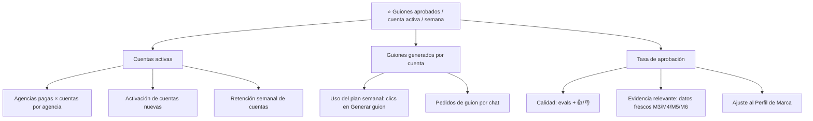

# Métricas norte y de producto

> Relacionados: [PRD](prd.md) · [Flujo guiado](flujo-guiado-simple.md) · [Costos de infra](../04-arquitectura/costos-de-infra.md) · [Evals y calidad](../05-agentes-ai/evals-y-calidad.md) · [Pricing y unit economics](../01-comercial/pricing-y-unit-economics.md)

---

## 1. North Star Metric

### **Guiones aprobados por cuenta cliente activa por semana** (GAS: Guiones Aprobados por Semana)

| Campo | Definición |
|---|---|
| Numerador | Guiones (`scripts`) que pasaron a `approved`, `recorded` o `published` dentro de la semana ISO (lunes a domingo, zona horaria de la cuenta). Cada guion cuenta una sola vez, en la semana de su primera aprobación |
| Denominador | Cuentas cliente **activas**: conectadas, no pausadas, con ≥ 1 sesión de un usuario en los últimos 14 días |
| Objetivo MVP | **≥ 3** por cuenta por semana ⚠️ (alineado con "3 acciones" del lunes) |
| Por qué esta | Captura el valor central (pasar de datos a **contenido listo para grabar**), es frecuente (semanal), la mueven todos los módulos (M3–M8) y predice la retención de la agencia: si su equipo aprueba guiones, el producto está en su flujo de trabajo |
| Métrica "hermana" (calidad) | **% de guiones aprobados que se publican** (`published / approved`, ventana de 14 días). Evita inflar la North Star con aprobaciones "de compromiso" |
| Métrica "de impacto" (Etapa 3+) | Rendimiento de los Reels publicados desde un guion contra el promedio de la cuenta (alcance o views relativos) y, con M12, ventas atribuidas |

### Árbol de la North Star

---

## 2. Métricas por etapa del funnel

### 2.1 Activación (cuenta cliente)

**Cuenta activada** = completa los 5 pasos dentro de los **7 días** desde su creación:

| Paso | Evento PostHog |
|---|---|
| 1. IG conectado | `social_account_connected` |
| 2. Perfil de Marca completo | `brand_profile_completed` |
| 3. ≥ 3 competidores válidos | `competitors_added` (con `count ≥ 3`) |
| 4. Primer análisis visto | `first_insight_viewed` |
| 5. Primer guion aprobado | `first_script_approved` |

| Métrica | Objetivo |
|---|---|
| % de cuentas activadas en ≤ 7 días | ≥ 70% ⚠️ |
| Tiempo mediano de creación de cuenta → primer guion aprobado | < 15 min (sesión) · < 24 h (calendario) |
| Drop-off por paso | Ningún paso con más de 25% de abandono ⚠️ |

**Activación de agencia (tenant):** branding configurado + ≥ 3 cuentas cliente activadas en los primeros 14 días.

### 2.2 Engagement y hábito

| Métrica | Definición | Objetivo |
|---|---|---|
| WAU de cuentas | Cuentas con ≥ 1 sesión o un guion aprobado en la semana | ≥ 80% de las cuentas activas |
| Apertura del plan del lunes | `weekly_plan_viewed` / planes generados | ≥ 60% |
| Acciones del Coach ejecutadas | Acciones convertidas en guion o calendario / acciones propuestas | ≥ 50% |
| Mensajes de chat por cuenta por semana | Descriptiva (no es objetivo: más chat no es necesariamente mejor) | — |
| Apertura del reporte por el cliente final | Aperturas de email + vistas del link / reportes enviados | ≥ 50% |

### 2.3 Retención y churn

| Métrica | Definición | Objetivo |
|---|---|---|
| Retención semanal de cuentas (cohortes) | % de cuentas activas en la semana N que fueron creadas en la semana 0 | Curva que se aplana ≥ 60% en la semana 8 ⚠️ |
| Logo churn de agencias (mensual) | Agencias que cancelan / agencias al inicio del mes | < 4% ⚠️ |
| Revenue churn neto (NRR) | (MRR inicial + expansión − contracción − churn) / MRR inicial | > 100% (las agencias suman cuentas) |
| Churn de cuentas cliente dentro de la agencia | Cuentas desactivadas / cuentas | < 6% mensual ⚠️ |
| Señales tempranas de churn | Token vencido sin reconectar > 7 días; 0 guiones aprobados 2 semanas seguidas; reporte no abierto 3 semanas | Alerta a CS interno |

### 2.4 Satisfacción

| Métrica | Cómo | Frecuencia |
|---|---|---|
| NPS agencia | In-app al `agency_owner` (día 30 y después cada 90 días) | Trimestral |
| NPS cliente final | Link en el pie del reporte semanal (1 pregunta) | Trimestral |
| CSAT de respuestas AI | 👍/👎 en mensajes, acciones y guiones | Continuo |
| Objetivo NPS agencias | ≥ 30 (Etapa 2) ⚠️ · ≥ 45 (mes 12) ⚠️ | — |

### 2.5 Negocio

| Métrica | Objetivo (ver [Etapas](../07-roadmap/etapas.md)) |
|---|---|
| Agencias pagas | 5 (fin Etapa 2) · 15 (mes 6) ⚠️ |
| MRR | USD 2,5–5k (fin Etapa 2) · ~10k (mes 6) · 30k (mes 12) ⚠️ |
| ARPA (MRR / agencia) | ≥ USD 600 ⚠️ |
| Cuentas cliente por agencia | ≥ 6 (promedio) ⚠️ |
| Margen bruto | > 80% |

---

## 3. Métricas de costo AI e infraestructura por cuenta

| Métrica | Fuente | Objetivo | Alerta |
|---|---|---|---|
| Costo LLM por cuenta por mes | `usage_costs` (kind=`llm`) | ≤ USD 8 | > USD 12 |
| Costo de transcripción por cuenta por mes | `usage_costs` (kind=`transcription`) | ≤ USD 3 | > USD 5 |
| Costo de scraping/proxy por cuenta por mes | `usage_costs` (kind=`proxy`) prorrateado | ≤ USD 5 | > USD 8 |
| **Costo variable total por cuenta** | Suma | **≤ USD 10** (techo USD 25) | > USD 15 en el mes |
| Costo por guion aprobado | Costo LLM del Guionista / guiones aprobados | ≤ USD 0,30 ⚠️ | > USD 1 |
| Cache hit ratio (tokens) | `cache_read_input_tokens / (input + cache_read + cache_creation)` | ≥ 60% en el chat | < 30% |
| % de tokens procesados por Haiku | Tokens de Haiku / tokens totales | ≥ 40% ⚠️ | — |
| % de llamadas de Opus | Llamadas Opus / llamadas totales | ≤ 3% | > 10% |
| Margen bruto por tenant | (Ingreso del tenant − costo variable de sus cuentas) / ingreso | > 80% | < 70% |

Dashboard interno "Costos" (solo `platform_admin`): top 10 cuentas por costo, costo por agente y por módulo, tendencia diaria. Ver [Costos de infra](../04-arquitectura/costos-de-infra.md).

---

## 4. Calidad de la AI (se resume acá, detalle en evals)

| Métrica | Definición | Objetivo |
|---|---|---|
| Tasa de aprobación de guiones | `approved / generated` (sin contar regeneraciones del mismo pedido) | ≥ 40% ⚠️ |
| Ediciones antes de aprobar | Distancia de edición normalizada entre la versión generada y la aprobada | < 30% ⚠️ |
| 👍 rate | 👍 / (👍 + 👎) por agente | ≥ 80% |
| Groundedness | % de afirmaciones con dato citado (eval offline) | ≥ 95% |
| Alucinación de métricas | Respuestas con números que no salen de tools (eval offline) | 0 tolerancia |

Ver [Evals y calidad](../05-agentes-ai/evals-y-calidad.md).

---

## 5. Plan de instrumentación (PostHog)

### 5.1 Convenciones

- Nombres en `snake_case`, verbo en pasado: `script_approved`.
- **Propiedades globales** (super properties) en cada evento: `tenant_id`, `client_account_id` (si aplica), `user_role`, `plan`, `is_white_label`, `app_version`.
- `distinct_id` = `user_id` interno (nunca email). Group analytics: `tenant` y `client_account`.
- Sin PII en propiedades: nada de captions completos, emails ni tokens.
- Eventos de backend (jobs, costos) con `posthog-node` desde el worker; eventos de UI con `posthog-js`.

### 5.2 Eventos a instrumentar

| Evento | Dónde | Propiedades clave |
|---|---|---|
| `tenant_signed_up` | web | `source`, `founders_offer` |
| `branding_configured` | web | `has_custom_domain` |
| `custom_domain_verified` | worker | — |
| `client_account_created` | web | `timezone`, `country` |
| `onboarding_step_completed` | web | `step`, `duration_s` |
| `social_account_connect_started` | web | `method` (`fb_login`/`ig_login`/`link`) |
| `social_account_connected` | web | `ig_followers_bucket`, `method` |
| `social_account_connect_failed` | web | `reason` (`personal_account`, `no_page`, `cancelled`, `error`) |
| `connection_link_sent` | web | — |
| `brand_profile_completed` | web | `via` (`chat`/`form`/`import`) |
| `competitors_added` | web | `count`, `invalid_count` |
| `ads_tracking_enabled` | web | `advertisers_count` |
| `ingest_completed` | worker | `kind` (`own_initial`/`own_daily`/`competitors`/`ads`), `items`, `duration_s`, `status` |
| `scrape_job_finished` | worker (aislado) | `status` (mismos `Status` del scrapper), `ads_new`, `duration_s`, `proxy_used` |
| `video_analyzed` | worker | `source` (`own`/`competitor`/`ad`/`upload`), `duration_s_video`, `cost_usd` |
| `first_insight_viewed` | web | `time_since_account_created_s` |
| `chat_message_sent` | web | `thread_kind`, `via_quick_reply` |
| `chat_response_completed` | web | `agent`, `latency_first_token_ms`, `tools_used`, `cost_usd` |
| `quick_reply_clicked` | web | `action` |
| `weekly_plan_generated` | worker | `actions_count`, `cost_usd` |
| `weekly_plan_viewed` | web | `role` |
| `coach_action_converted` | web | `to` (`script`/`calendar`) |
| `script_generated` | web/worker | `origin` (`coach_action`/`chat`/`manual`), `variant_count`, `prompt_version`, `cost_usd` |
| `script_rewrite_requested` | web | `instruction` (`shorter`/`bolder`/`other`) |
| `script_approved` | web | `role`, `edit_distance_pct`, `minutes_since_generated` |
| `first_script_approved` | web | `time_since_account_created_s` |
| `script_rejected` | web | `reason` |
| `script_published_linked` | web/worker | `auto_matched` |
| `ai_feedback_given` | web | `agent`, `target` (`message`/`action`/`script`), `rating` (`up`/`down`), `reason_tag` |
| `calendar_item_moved` | web | `from_status`, `to_status` |
| `report_generated` | worker | `format`, `pages` |
| `report_sent` | worker | `recipients_count`, `scheduled` |
| `report_opened` | web (pixel/link) | `opener_role` |
| `token_expired_detected` | worker | `days_since_connect` |
| `plan_limit_reached` | web/worker | `limit` (`accounts`/`competitors`/`video_minutes`) |
| `subscription_started` / `subscription_changed` / `subscription_canceled` | worker (webhook de Stripe) | `plan`, `mrr_usd`, `reason` |
| `nps_submitted` | web | `score`, `respondent` (`agency`/`client`) |

### 5.3 Dashboards PostHog (mínimos)

1. **Activación**: funnel de 5 pasos por cohorte semanal.
2. **North Star**: GAS por semana, desglosado por agencia.
3. **Hábito del lunes**: plan generado → visto → acción convertida → guion aprobado.
4. **Calidad AI**: 👍 rate por agente y `prompt_version`.
5. **Salud de datos**: `ingest_completed` y `scrape_job_finished` por estado.
6. **Costos**: suma de `cost_usd` por tenant (cruzado con `usage_costs` en la DB, que es la fuente de verdad contable).

> **Fuente de verdad:** costos y facturación se calculan desde Postgres (`usage_costs`, `subscriptions`). PostHog es para análisis de producto y puede perder eventos.
