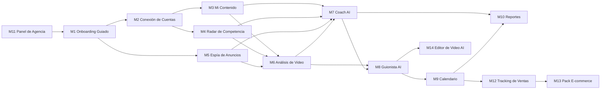

# Módulos M1–M14: fichas

> IDs canónicos y estables. MVP = **M1–M11** (M9 en versión simple).
> Relacionados: [PRD](prd.md) · [Flujo guiado](flujo-guiado-simple.md) · [Arquitectura multiagente](../05-agentes-ai/arquitectura-multiagente.md) · [Modelo de datos](../04-arquitectura/modelo-de-datos.md) · [Etapas](../07-roadmap/etapas.md)

## Mapa de dependencias

## Resumen

| ID | Módulo | Fuente de datos | Agente AI | Etapa | Sprint |
|---|---|---|---|---|---|
| M1 | Onboarding Guiado | Usuario (chat) | Orquestador/Guía | 1 | S4 |
| M2 | Conexión de Cuentas | Meta OAuth | — | 1 | S2 |
| M3 | Mi Contenido | Graph API (IG/FB propio) | Analista de Contenido | 1 | S2 |
| M4 | Radar de Competencia | Business Discovery API | Radar de Competencia | 1 | S3 |
| M5 | Espía de Anuncios | Scrapper Biblioteca de Anuncios | Analista de Anuncios | 1 | S3 |
| M6 | Análisis de Video | media_url + transcripción | Analista de Contenido | 1 | S4 |
| M7 | Coach AI | Todo lo anterior | Coach de Crecimiento | 1 | S5 |
| M8 | Guionista AI | Análisis + Perfil de Marca | Guionista | 1 | S5 |
| M9 | Calendario | Guiones + posts | — (Coach sugiere) | 1 (simple) | S5 |
| M10 | Reportes | Agregados | Coach (redacta resumen) | 1 | S5 |
| M11 | Panel de Agencia | Tenants y billing | — | 2 | S6 |
| M12 | Tracking de Ventas | Plataformas de pago, UTMs, WhatsApp | Agente de Tracking | 3 | — |
| M13 | Pack E-commerce | Catálogo, tienda, ads | Agentes existentes + prompts e-com | 4 | — |
| M14 | Editor de Video AI | Videos crudos del usuario | Editor (nuevo) | 5 | — |

---

## M1 · Onboarding Guiado

| Campo | Detalle |
|---|---|
| **Qué hace** | Conversación paso a paso que arma el **Perfil de Marca** (nicho, avatar, oferta, tono, competidores), conecta cuentas y lleva al usuario al primer análisis y al primer guion. Después sigue siendo la "puerta de entrada" del chat |
| **Fuente de datos** | Respuestas del usuario; validación de @handles con Business Discovery; Perfil de Marca existente |
| **Agente AI** | **Orquestador/Guía** (`claude-sonnet-5-5`). Delega en los demás agentes |
| **Pantallas** | Chat a pantalla completa (onboarding) · Checklist de activación (barra lateral) · Formulario "Perfil de Marca" (edición) |
| **Etapa / Sprint** | Etapa 1 · S4 (base), se pule en S7 |
| **Dependencias** | M2 (conectar), M4 (validar competidores), packages/ai |
| **Riesgos** | El chat se "va por las ramas" → guardrails y pasos con estado explícito (`onboarding_step`). Usuarios que prefieren formularios → ofrecer siempre "completar con formulario" |
| **Criterio de listo** | Un usuario nuevo llega a su primer guion aprobado en < 15 min sin ayuda humana |

## M2 · Conexión de Cuentas

| Campo | Detalle |
|---|---|
| **Qué hace** | OAuth con Meta (Facebook Login for Business); selección de página + IG Business; guarda tokens cifrados; refresh, revocación y data deletion |
| **Fuente de datos** | Meta Graph API: `/me/accounts`, `{page-id}?fields=instagram_business_account` |
| **Permisos** | `instagram_basic`, `instagram_manage_insights`, `pages_show_list`, `pages_read_engagement`, `business_management` ⚠️ confirmar en [App Review](../03-meta-y-legal/meta-app-review-y-permisos.md) |
| **Agente AI** | Ninguno (el Guía solo explica los pasos) |
| **Pantallas** | Botón "Conectar Instagram" · Selector de página/IG · Estado de conexión · Link de conexión para el cliente final |
| **Etapa / Sprint** | Etapa 1 · S2 |
| **Dependencias** | App de Meta en modo desarrollo + usuarios de prueba; después Advanced Access |
| **Riesgos** | Cuentas IG personales (no Business/Creator) → guía para convertirla. IG sin página vinculada → guía o ruta Instagram Login. Tokens que vencen → job de chequeo diario |

## M3 · Mi Contenido

| Campo | Detalle |
|---|---|
| **Qué hace** | Ingesta y dashboard del contenido propio: posts, Reels, insights por post y por cuenta, ranking, curva de métricas en el tiempo |
| **Fuente de datos** | Graph API: `/{ig-user-id}/media`, `/{media-id}/insights` (reach, views ⚠️, likes, comments, saved, shares), `/{ig-user-id}/insights` |
| **Agente AI** | **Analista de Contenido**: clasifica posts (Haiku) y explica qué funcionó (Sonnet) |
| **Pantallas** | Dashboard (KPIs + gráfico semanal) · Lista de posts con filtros · Detalle de post (métricas + análisis M6) |
| **Etapa / Sprint** | Etapa 1 · S2 |
| **Dependencias** | M2 |
| **Riesgos** | Las métricas disponibles cambian por versión de la API (p. ej., deprecaciones de `impressions`/`plays` a favor de `views`) ⚠️ → capa `packages/meta-graph` con mapeo versionado. Rate limits (BUC) → backoff + ingesta escalonada |

## M4 · Radar de Competencia

| Campo | Detalle |
|---|---|
| **Qué hace** | Sigue hasta 10 competidores por cuenta cliente: snapshot diario de seguidores y posts, top posts por engagement relativo, alertas de "post fuera de serie", resumen semanal AI |
| **Fuente de datos** | **Business Discovery API** (`/{ig-user-id}?fields=business_discovery.username(handle){followers_count,media_count,media{caption,like_count,comments_count,timestamp,permalink,media_type,media_url}}`). Solo cuentas Business/Creator públicas. **No** da reach, views ni saves |
| **Agente AI** | **Radar de Competencia**: etiqueta temas y formatos (Haiku) y redacta "qué cambió esta semana" (Sonnet) |
| **Pantallas** | Lista de competidores (tarjetas con delta de seguidores) · Feed de top posts de la competencia · Detalle del competidor · Comparativa vs. mi cuenta |
| **Etapa / Sprint** | Etapa 1 · S3 |
| **Dependencias** | M2 (hace falta el token de un IG Business del cliente para llamar a Business Discovery) |
| **Riesgos** | `like_count` oculto por el competidor → null; media_url ausente en algunos Reels ⚠️; rate limit por token → agrupar llamadas y repartirlas en el día |

## M5 · Espía de Anuncios

| Campo | Detalle |
|---|---|
| **Qué hace** | Sigue anunciantes (page_id) y búsquedas (palabra clave + país) en la Biblioteca de Anuncios; guarda anuncios activos con texto, CTA, destino (WhatsApp/Messenger/IG/web), plataformas, fecha de inicio y media; detecta "anuncios ganadores" por longevidad |
| **Fuente de datos** | **Scrapper** (`packages/meta-ads-scraper`, port de `src/extractors.ts`) en worker aislado. Respaldo: proveedor externo (p. ej., Apify actor) ⚠️. La Ad Library API oficial **no** cubre anuncios comerciales de LATAM |
| **Agente AI** | **Analista de Anuncios**: agrupa por ángulo y oferta (Haiku) y explica estrategia (Sonnet) |
| **Pantallas** | Anunciantes seguidos · Feed de anuncios (filtros: activo, destino, antigüedad) · Detalle de anuncio · "Ángulos que se repiten" |
| **Etapa / Sprint** | Etapa 1 · S3 |
| **Dependencias** | Worker de scraping, Redis/BullMQ, R2 (media), [ADR 0003](../04-arquitectura/adr/0003-scrapper-como-worker.md) |
| **Riesgos** | **Riesgo legal y operativo** (viola los Términos de Meta): aislamiento total, solo datos públicos, rate limit, proxies. Cambios en el GraphQL de Meta rompen el parser → tests de fixtures + alerta. Ver [Ads Library y scraping](../03-meta-y-legal/ads-library-y-scraping.md) |

## M6 · Análisis de Video

| Campo | Detalle |
|---|---|
| **Qué hace** | Descarga el video (propio, de competidor o de anuncio), lo transcribe con timestamps y lo analiza: hook (0–3 s), promesa, ángulo, estructura por beats, CTA, emociones, ritmo. Opcional: frames clave con visión |
| **Fuente de datos** | `media_url` (Graph API / Business Discovery), media del snapshot del anuncio, subida manual |
| **Agente AI** | **Analista de Contenido** (`claude-sonnet-5-5`; `claude-opus-5-5` solo para análisis profundo a pedido) |
| **Pantallas** | Detalle de video (player + transcript sincronizado + tarjeta de análisis) · "Biblioteca de hooks" (todos los hooks analizados, filtrables) |
| **Etapa / Sprint** | Etapa 1 · S4 |
| **Dependencias** | M3, M4, M5, proveedor de transcripción ([ADR 0004](../04-arquitectura/adr/0004-proveedor-llm-y-transcripcion.md)), R2 con TTL |
| **Riesgos** | Costo de transcripción a escala → límite de minutos por plan y dedupe por hash. URLs de media que expiran → descargar apenas se ingesta. Derechos de autor → guardar solo para análisis, con TTL 30 días ⚠️ |

## M7 · Coach AI

| Campo | Detalle |
|---|---|
| **Qué hace** | Plan semanal (lunes) con diagnóstico + **3 acciones** priorizadas y justificadas con evidencia; chat sobre los datos; seguimiento de lo recomendado contra el resultado |
| **Fuente de datos** | Insights agregados de M3–M6, Perfil de Marca, historial de recomendaciones y feedback |
| **Agente AI** | **Coach de Crecimiento** (`claude-sonnet-5-5`; corrida mensual profunda con `claude-opus-5-5`) |
| **Pantallas** | Home de la cuenta ("Tu semana": 3 tarjetas de acción) · Chat · Historial de planes |
| **Etapa / Sprint** | Etapa 1 · S5 |
| **Dependencias** | M3, M4, M5, M6 |
| **Riesgos** | Consejos genéricos → evidencia obligatoria (cada acción cita ≥ 1 dato) + evals. Alucinar métricas → las métricas solo se leen con tools, nunca de memoria |

## M8 · Guionista AI

| Campo | Detalle |
|---|---|
| **Qué hace** | Genera guiones de Reels/TikTok (**hook → desarrollo → CTA**), con duración objetivo, texto en pantalla, indicaciones de toma/b-roll, 3 variantes de hook y referencias a lo que funcionó (competidores + contenido propio). Permite reescrituras ("más corto", "más polémico", "para lanzamiento") |
| **Fuente de datos** | Análisis M6, top posts M3/M4, ángulos M5, Perfil de Marca, guiones aprobados anteriores (estilo) |
| **Agente AI** | **Guionista** (`claude-sonnet-5-5`) — prompt en [guionista.md](../05-agentes-ai/prompts/guionista.md) |
| **Pantallas** | Generador (brief corto o "desde acción del Coach") · Editor de guion · Lista de guiones con estados |
| **Etapa / Sprint** | Etapa 1 · S5 |
| **Dependencias** | M6, M7, Perfil de Marca |
| **Riesgos** | Copiar literalmente a competidores → regla explícita: inspirarse en estructura, nunca copiar texto. Promesas engañosas (salud, dinero) → guardrails de claims |

## M9 · Calendario (simple en el MVP)

| Campo | Detalle |
|---|---|
| **Qué hace** | Lista o kanban semanal: idea → guion → grabado → publicado. Vincula el post publicado para medir el resultado del guion |
| **Fuente de datos** | `scripts`, `content_calendar`, posts de M3 (auto-match por fecha + similitud de caption) |
| **Agente AI** | Ninguno propio; el Coach propone el plan y lo carga |
| **Pantallas** | Semana (lista/kanban) · Modal de ítem |
| **Etapa / Sprint** | Etapa 1 · S5 (simple); vista mensual drag & drop post-MVP |
| **Dependencias** | M8, M3 |
| **Riesgos** | Bajo. Que nadie actualice los estados → auto-detección del post publicado |

## M10 · Reportes

| Campo | Detalle |
|---|---|
| **Qué hace** | Reporte semanal por cuenta cliente (KPIs, top posts, competencia, 3 acciones, guiones) en PDF + email + link web, con la marca de la agencia |
| **Fuente de datos** | Agregados de M3–M9 |
| **Agente AI** | Coach redacta el resumen ejecutivo (puede ir por **Batches API**, a mitad de costo) |
| **Pantallas** | Vista previa del reporte · Configuración (día, hora, destinatarios, comentario de la agencia) · Historial de envíos |
| **Etapa / Sprint** | Etapa 1 · S5 |
| **Dependencias** | M7, M11 (branding), Resend, generador de PDF (React-PDF o Playwright print) |
| **Riesgos** | Emails a spam → dominio verificado (SPF/DKIM) por agencia. Reporte con datos viejos → mostrar "datos al: fecha" |

## M11 · Panel de Agencia

| Campo | Detalle |
|---|---|
| **Qué hace** | Multi-cliente: lista de cuentas con salud, usuarios y permisos, branding (logo, colores, nombre), dominio custom, billing (Stripe; MercadoPago opcional), uso y límites |
| **Fuente de datos** | `tenants`, `branding`, `client_accounts`, `subscriptions`, `usage_costs` |
| **Agente AI** | Ninguno (a futuro: "resumen de la cartera" por el Coach) |
| **Pantallas** | Cartera de clientes · Configuración de marca · Dominio · Equipo · Facturación · Uso |
| **Etapa / Sprint** | Etapa 2 · S6 (la estructura multi-tenant existe desde S1) |
| **Dependencias** | Vercel Domains API (dominio custom + SSL), Stripe, Resend domains |
| **Riesgos** | Fugas de marca ("Jeder AI" visible) → checklist de QA. Errores de DNS de las agencias → asistente paso a paso + verificación automática |

---

## M12 · Tracking de Ventas (Etapa 3)

| Campo | Detalle |
|---|---|
| **Qué hace** | Atribuye ventas a contenido: UTMs y links cortos por guion/post, webhooks de plataformas de pago (Hotmart, Kiwify, Stripe, MercadoPago ⚠️), conversaciones de WhatsApp. Muestra "este Reel trajo X ventas" |
| **Fuente de datos** | Webhooks de pago, redirect propio de links, `tracking_events` |
| **Agente AI** | **Agente de Tracking** (conecta ventas con contenido y alimenta al Coach) |
| **Pantallas** | Ventas por contenido · Configuración de integraciones · Links trackeados |
| **Etapa** | 3 (meses 5–6) |
| **Dependencias** | M9 (vincular contenido), ver [Tracking para infoproductores](../06-tracking/tracking-infoproductores.md) |
| **Riesgos** | Atribución imperfecta (dark social, DMs) → mostrar rangos y método. Privacidad de datos de compradores → minimizar PII |

## M13 · Pack E-commerce (Etapa 4)

| Campo | Detalle |
|---|---|
| **Qué hace** | Adapta el producto a tiendas: análisis de anuncios de producto, catálogo, ángulos de oferta (descuento, envío, UGC), guiones UGC, métricas de tienda (Shopify/Tiendanube ⚠️) |
| **Fuente de datos** | Lo de M3–M5 + integraciones de tienda |
| **Agente AI** | Agentes existentes con prompts y rúbricas e-commerce |
| **Etapa** | 4 (meses 7–9), junto con self-serve |
| **Riesgos** | Dispersión de foco → entra solo si las agencias de infoproductores están validadas |

## M14 · Editor de Video AI (Etapa 5)

| Campo | Detalle |
|---|---|
| **Qué hace** | A partir del video crudo grabado con el guion: cortes automáticos, subtítulos, b-roll sugerido, versiones de hook. "Comoditiza" parte del trabajo de la agencia |
| **Fuente de datos** | Videos subidos por el usuario, guion M8 |
| **Agente AI** | Editor (nuevo); posiblemente servicios de terceros de edición y subtitulado ⚠️ |
| **Etapa** | 5 (mes 10+) |
| **Riesgos** | Costo de cómputo de video alto; competencia fuerte (CapCut, Opus Clip, etc.) → evaluar build vs. integrar |
