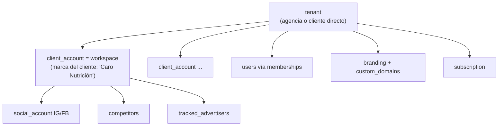

# ADR 0002: Multi-tenant con marca blanca (tenant → cuenta cliente)

| Campo | Valor |
|---|---|
| **Estado** | Aceptado |
| **Fecha** | 2026-10 |
| **Decisores** | Sergio (Tech Lead), PO |
| **Relacionados** | [Modelo de datos](../modelo-de-datos.md) · [Arquitectura general](../arquitectura-general.md) · [Modelo de marca blanca](../../01-comercial/modelo-marca-blanca.md) · [PRD](../../02-producto/prd.md) |

## Contexto

- El canal #1 es **marca blanca para agencias**: cada agencia ve el producto con su logo, colores, nombre y dominio (`app.agencia.com`) y gestiona entre 5 y 60 cuentas cliente.
- En Etapa 4 llega el **público final self-serve** (un infoproductor con 1–3 cuentas).
- Los datos de cada agencia y de cada cliente deben estar **aislados** (requisito de confianza y de las políticas de Meta).
- Hay datos **públicos** (anuncios de la Biblioteca) que conviene compartir entre tenants para no scrapear lo mismo dos veces.
- Equipo chico: no se puede operar una base por tenant.

## Decisión

1. **Base de datos compartida, esquema compartido, columna `tenant_id` + RLS** en Postgres (Supabase).
2. Jerarquía de 3 niveles:

   - **tenant**: unidad de facturación y de marca blanca. Una agencia = un tenant. En Etapa 4, un infoproductor self-serve = un tenant con `kind='direct'` y sin marca blanca.
   - **client_account** (en la UI, "cliente" o "cuenta"; en el brief, "workspace"): la marca de un cliente final. Unidad de límites del plan (5/20/60 cuentas).
   - **social_account**: IG/FB conectado a una cuenta cliente.
3. **Permisos**: `memberships(user_id, tenant_id, role)` + `account_assignments(user_id, client_account_id)` para `agency_member` y `client_viewer`.
4. **Datos públicos globales** (sin `tenant_id`): `advertisers`, `ads`, `ad_observations`, `media_assets` de anuncios, porque vienen del scrapper (no de tokens de clientes). El tenant los "sigue" vía `tracked_advertisers` (con `tenant_id`). Los análisis AI de esos anuncios sí son por tenant (pueden usar el Perfil de Marca).
5. **Datos obtenidos con tokens de clientes** (Graph API, Business Discovery) son **por tenant**, aunque dos agencias sigan al mismo competidor. ⚠️ Compartirlos entre tenants está pendiente de validación legal con las políticas de Meta Platform: por defecto, no se comparten.
6. **Resolución del tenant por host**: `custom_domains(host → tenant_id)`; `middleware.ts` setea el contexto de marca. Si el host es el dominio genérico, el tenant sale de la sesión (y un usuario con varios tenants elige).
7. **Theming** por tokens CSS desde `branding`; emails (Resend con dominio verificado por tenant) y PDFs usan el mismo `branding`. El texto "Jeder AI" no aparece en tenants `white_label=true`.
8. **Token para Business Discovery**: se usa el token del IG Business de **la propia cuenta cliente**. Si la cuenta todavía no conectó IG, se puede usar el IG Business de la agencia (`tenant.default_social_account_id`) como "token de servicio" ⚠️, a validar con App Review y las políticas de uso.

## Alternativas consideradas

| Alternativa | Pros | Contras | Veredicto |
|---|---|---|---|
| **Una base (o un schema) por tenant** | Aislamiento fuerte | Migraciones × N, costos, operación imposible para 1 dev | Descartada |
| **Sin RLS, solo filtros en la app** | Simple | Un bug = fuga de datos entre agencias | Descartada (RLS + filtros en la app = defensa en profundidad) |
| **2 niveles (tenant = cliente final)** | Más simple | No modela agencias con muchas cuentas ni la reventa | Descartada |
| **Subdominios `agencia.jeder.ai` en vez de dominio propio** | Sin DNS del cliente | Rompe la marca blanca (se ve "jeder") | Se ofrece como default; dominio propio como upgrade |
| **Compartir datos de competidores entre tenants** | Ahorra llamadas a la API | Riesgo con las políticas de Meta | No por ahora ⚠️ |

## Consecuencias

**Positivas**
- Un solo deploy y una sola migración para todos los tenants.
- Agregar un cliente es crear una fila: escala comercial sin trabajo de infra.
- Los datos públicos de anuncios se scrapean una vez y sirven a todos (menos costo de proxy y menos riesgo de bloqueo).

**Negativas / riesgos**
- RLS mal escrita = fuga. Mitigación: **tests automáticos de aislamiento** en CI (crear 2 tenants, intentar leer cruzado con cada rol), revisión obligatoria de cada policy nueva, helper único `withTenant(tx, ctx)`.
- Rendimiento: las policies agregan joins → `tenant_id` en todas las tablas (denormalizado) e índices que empiecen por `tenant_id`.
- "Noisy neighbor" en colas: límites por tenant en BullMQ (grupos o rate limiter por `tenantId`).
- Dominios custom: soporte de DNS → asistente con verificación automática y docs para la agencia.

## Checklist

- [ ] Tablas `tenants`, `memberships`, `account_assignments`, `client_accounts`, `branding`, `custom_domains` (S1).
- [ ] Función SQL `app.current_tenant()` + policies base (S1).
- [ ] Suite `rls.test.ts` en CI (S1).
- [ ] `middleware.ts` con resolución por host + cache (S6).
- [ ] Vercel Domains API + verificación DNS (S6).
- [ ] Resend domains por tenant (S6).
- [ ] QA "sin fuga de marca" (emails, PDF, títulos, favicon, OG tags) (S6–S7).
