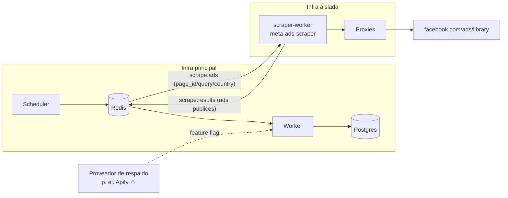

# ADR 0003: El scrapper de la Biblioteca de Anuncios corre como worker aislado

| Campo | Valor |
|---|---|
| **Estado** | Aceptado |
| **Fecha** | 2026-10 |
| **Decisores** | Sergio (Tech Lead), PO |
| **Relacionados** | [Reutilización del scrapper](../reutilizacion-del-scrapper.md) · [Ads Library y scraping](../../03-meta-y-legal/ads-library-y-scraping.md) · [Proxies](../../03-meta-y-legal/proxies.md) · [Arquitectura general](../arquitectura-general.md) |

## Contexto

- M5 (Espía de Anuncios) necesita anuncios **comerciales** de LATAM. La **Ad Library API** oficial solo cubre anuncios políticos o de temas sociales y anuncios entregados en la UE (DSA) → no sirve para nuestro caso.
- Existe un scrapper probado (`src/extractors.ts` + `src/storage.ts`, CLI local con SQLite) que intercepta `AdLibrarySearchPaginationQuery` con fallback DOM, circuit breaker de errores GraphQL y parada segura en 403/429.
- Scrapear viola los Términos de Meta → **riesgo legal y operativo**. Si Meta vincula el scraping a nuestra App oficial (Tech Provider), podríamos perder el acceso a la Graph API, que es el núcleo del producto.
- El CLI actual es interactivo (sesión visible, `+N`, `r`, `q`), usa perfiles de navegador locales y SQLite con `node:sqlite`. No sirve tal cual en servidor.

## Decisión

1. Portar el motor a `packages/meta-ads-scraper` (ver [plan de migración](../reutilizacion-del-scrapper.md)) con una interfaz pura:
   ```ts
   scrapeAds(input: ScrapeInput, deps: { sink: AdSink; signal: AbortSignal; proxy?: ProxyConfig }): Promise<ScrapeResult>
   ```
   Sin dependencia de Postgres ni de la app: recibe un `sink` para emitir lotes.
2. Ejecutarlo en **`apps/scraper-worker`**, un proceso BullMQ que consume solo la cola `scrape:ads` y publica en `scrape:results`.
3. **Aislamiento fuerte:**

| Aspecto | Regla |
|---|---|
| Infraestructura | Otro proyecto o cuenta de hosting (p. ej., Railway project separado o Fly app en otra org), otra IP de salida |
| Credenciales | Ningún token de cliente, ningún secret de la App de Meta, ninguna credencial de la DB principal |
| Red | Solo sale por proxies residenciales hacia `facebook.com`; entra solo Redis con un usuario ACL limitado a `bull:scrape:*` |
| Datos | Recibe `page_id`, `query` y `country`; nunca `tenant_id` ni datos de clientes. Devuelve solo datos públicos |
| Identidad | Sin login en Facebook (navegación anónima). Nunca usar cuentas de FB de clientes ni de la agencia |

4. **Ritmo y protección:** concurrencia 1 Chromium por instancia (2 GB RAM), pausas humanas ya implementadas (`SCROLL_PAUSE_MS`, `PAGINATION_PAUSE_MS` con jitter), límite de anuncios por job, dedupe global (un anunciante seguido por 10 agencias se scrapea 1 vez), circuit breaker global ante `RATE_LIMITED`/`ACCESS_DENIED`.
5. **Proveedor de respaldo** detrás de la misma interfaz (`AdsSource`): p. ej., un actor de Apify ⚠️, activable por feature flag si el scrapper propio falla más de 48 h.
6. **El valor central no depende de M5:** si M5 se cae, M3/M4/M6/M7/M8 siguen funcionando y la UI muestra el último dato válido.



## Alternativas consideradas

| Alternativa | Pros | Contras | Veredicto |
|---|---|---|---|
| **Scrapper dentro de `apps/worker`** | Menos infra | Mezcla credenciales y la IP con la App oficial; un bloqueo afecta todo | Descartada |
| **Solo proveedor externo (Apify, etc.)** | Cero mantenimiento de Playwright | Costo por resultado ⚠️, dependencia, menos control de campos | Respaldo, no principal |
| **Ad Library API oficial** | Legal y estable | No cubre anuncios comerciales LATAM | No aplica (sí para UE si algún día hace falta) |
| **Scraping desde el navegador del usuario (extensión)** | IP residencial gratis | Fricción, soporte, imagen poco profesional | Descartada para el MVP |
| **Sin M5** | Cero riesgo | Pierde un diferencial muy pedido por agencias de infoproductores | Descartada; se mantiene aislado |

## Consecuencias

**Positivas**
- Se reutilizan cientos de horas de trabajo y los tests del scrapper actual.
- Un bloqueo de Meta queda contenido en la infra aislada.
- Escalado independiente (más instancias o IPs sin tocar el resto).

**Negativas / riesgos**
- Más infraestructura para operar (2 proyectos de hosting, ACL de Redis).
- Costo de proxies (USD 3–8/GB ⚠️) → bloquear imágenes/fuentes salvo cuando se captura media, y medir GB por job.
- Cambios en el GraphQL de Meta rompen el parser → fixtures de respuestas reales en tests + alerta si `ads_new = 0` en más del X% de jobs.
- Riesgo legal remanente → documentado en [Ads Library y scraping](../../03-meta-y-legal/ads-library-y-scraping.md); revisión legal antes de la Etapa 2.

## Checklist

- [ ] `packages/meta-ads-scraper` con API pura + tests portados (S3).
- [ ] `apps/scraper-worker` con Dockerfile Playwright, headless, sin perfiles persistentes (S3).
- [ ] Proyecto de hosting separado + usuario Redis con ACL (S3).
- [ ] Proxy configurable por job (`ProxyConfig`) y medición de bytes (S3–S7).
- [ ] Circuit breaker global + métricas `scrape_job_finished` (S3).
- [ ] Interfaz `AdsSource` + adapter de respaldo detrás de feature flag (S7 o Etapa 3).
