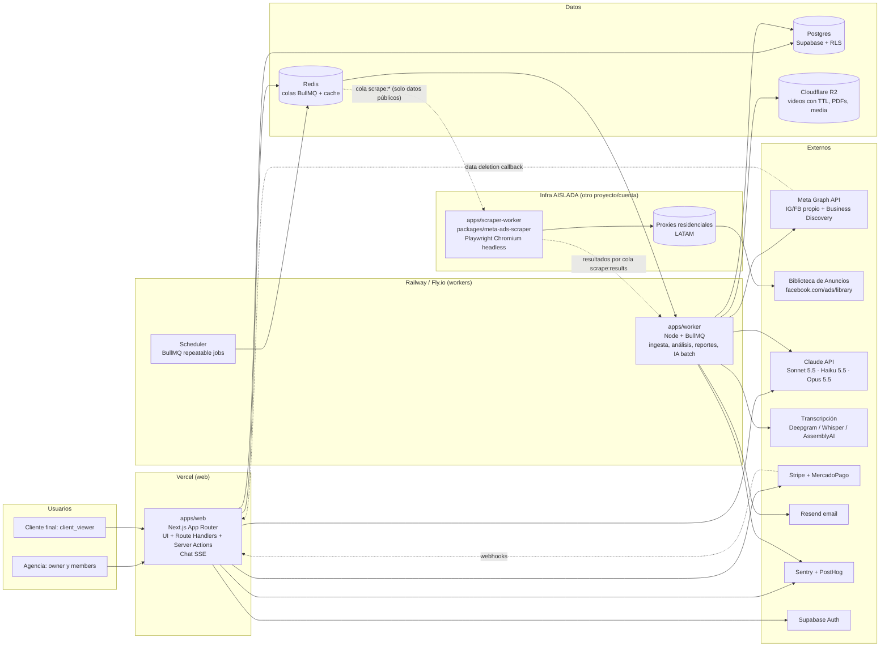
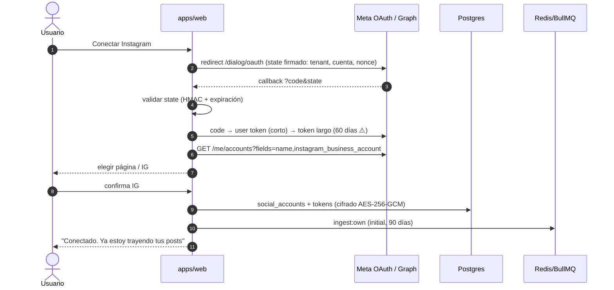
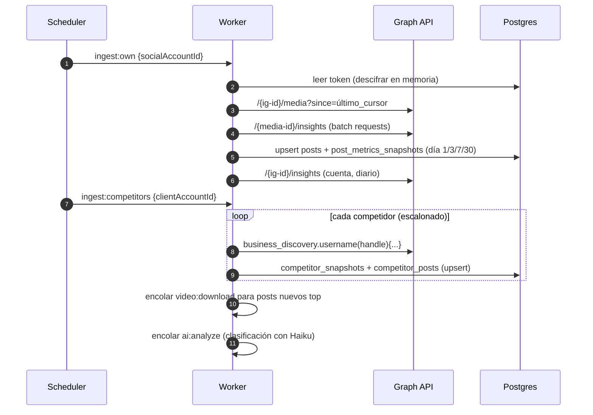
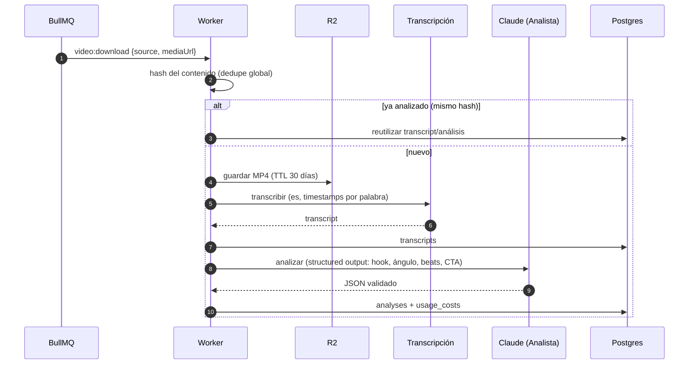
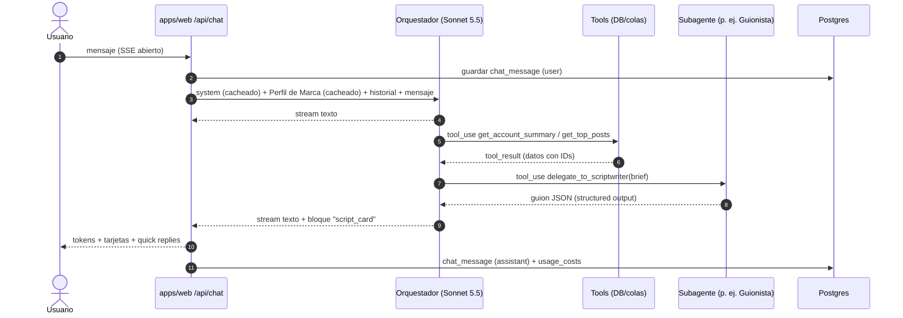

# Arquitectura general

> Relacionados: [ADR 0001 Stack](adr/0001-stack-typescript.md) · [ADR 0002 Multi-tenant](adr/0002-multi-tenant-marca-blanca.md) · [ADR 0003 Scrapper como worker](adr/0003-scrapper-como-worker.md) · [ADR 0004 LLM y transcripción](adr/0004-proveedor-llm-y-transcripcion.md) · [Modelo de datos](modelo-de-datos.md) · [Reutilización del scrapper](reutilizacion-del-scrapper.md) · [Costos](costos-de-infra.md) · [Multiagente](../05-agentes-ai/arquitectura-multiagente.md)

---

## 1. Vista de componentes



### Responsabilidades

| Componente | Responsabilidad | NO hace |
|---|---|---|
| `apps/web` | UI, auth, CRUD, chat en streaming (llama al Orquestador), webhooks (Stripe, Meta), encolar jobs | Trabajo pesado (> 10 s), Playwright, descargas de video |
| `apps/worker` | Ingesta Graph API, Business Discovery, descargar y transcribir videos, análisis LLM, plan semanal, reportes PDF, emails | Scraping (vive aislado) |
| `apps/scraper-worker` | Ejecutar `packages/meta-ads-scraper` con Playwright + proxies; devolver anuncios normalizados | Tocar tokens de clientes, la DB principal ni secrets de la App de Meta |
| Postgres (Supabase) | Fuente de verdad, RLS por tenant, Auth | Colas |
| Redis | BullMQ (colas, rate limiting, locks), cache corto | Persistencia de negocio |
| R2 | Videos (TTL 30 días ⚠️), thumbnails, PDFs de reportes, media de anuncios | Datos estructurados |

---

## 2. Estructura del monorepo (`jedertech-ai-platform`)

```
jedertech-ai-platform/
├── apps/
│   ├── web/                      Next.js (App Router) + Tailwind + shadcn/ui
│   │   ├── app/(marketing)/      landing / waitlist
│   │   ├── app/(app)/[account]/  pantallas por cuenta cliente
│   │   ├── app/api/chat/         route handler SSE → packages/ai (orquestador)
│   │   ├── app/api/webhooks/     stripe, meta (deauthorize, data-deletion)
│   │   └── middleware.ts         resuelve tenant por host (dominio custom)
│   ├── worker/                   BullMQ processors (ingest, video, ai, reports, billing)
│   └── scraper-worker/           proceso aislado que consume la cola scrape:* (deploy separado)
├── packages/
│   ├── db/                       Drizzle schema, migraciones, RLS policies (SQL), seeds
│   ├── meta-graph/               cliente Graph API tipado (IG media, insights, business discovery)
│   ├── meta-ads-scraper/         port de src/ del repo scrapper-meta-pro (ver reutilización)
│   ├── ai/                       Anthropic SDK, agentes, tools, prompts versionados, evals
│   ├── transcription/            interfaz Transcriber + adapters (deepgram, whisper, assemblyai)
│   ├── core/                     dominio: límites por plan, máquina de onboarding, permisos
│   ├── queue/                    definiciones de colas y payloads (zod) compartidas web↔worker
│   ├── reports/                  plantillas React-PDF / HTML de reportes
│   ├── ui/                       componentes shadcn compartidos + theming de marca blanca
│   └── config/                   eslint, tsconfig, tailwind preset
├── tooling/evals/                datasets y runners de evals (CI)
├── turbo.json · pnpm-workspace.yaml · .github/workflows/
```

Reglas: `apps/*` dependen de `packages/*`, nunca al revés. `packages/meta-ads-scraper` **no** depende de `packages/db` (recibe un `sink` inyectado), así puede correr aislado.

---

## 3. Colas (BullMQ)

| Cola | Productor | Consumidor | Concurrencia inicial | Reintentos |
|---|---|---|---|---|
| `ingest:own` | scheduler (diario), onboarding | worker | 5 | 5, backoff exponencial |
| `ingest:competitors` | scheduler (diario, escalonado) | worker | 3 por token | 3 |
| `scrape:ads` | scheduler (diario/semanal), UI | **scraper-worker** | 1–2 por instancia (un Chromium cada uno) | 2 + circuit breaker |
| `scrape:results` | scraper-worker | worker (persiste en DB) | 5 | 5 |
| `video:download` | ingest, UI | worker | 4 | 3 |
| `video:transcribe` | video:download | worker | 4 | 3 |
| `ai:analyze` | transcribe, ingest | worker | 4 (limitado por rate limit LLM) | 3 |
| `ai:weekly` | scheduler (domingo 22:00 local) | worker → Batches API | 1 (agrupa) | 2 |
| `reports:build` / `reports:send` | ai:weekly, UI | worker | 3 | 3 |
| `tokens:health` | scheduler (diario) | worker | 5 | 1 |
| `housekeeping` | scheduler | worker (TTL de videos, retención) | 1 | 1 |

Todas las payloads se validan con zod (`packages/queue`) e incluyen `tenantId`, `clientAccountId` y `jobRunId` (fila en `jobs`).

---

## 4. Flujos clave

### 4.1 Conexión de Instagram (M2)



Detalle de permisos y App Review: [meta-app-review-y-permisos.md](../03-meta-y-legal/meta-app-review-y-permisos.md).

### 4.2 Ingesta diaria (M3 + M4)



Rate limits: el cliente `packages/meta-graph` lee los headers `X-App-Usage` / `X-Business-Use-Case-Usage` y hace backoff antes de llegar al 100% ⚠️.

### 4.3 Espía de anuncios (M5)

```mermaid
sequenceDiagram
  autonumber
  participant S as Scheduler
  participant Q as Redis (scrape:ads)
  participant SW as scraper-worker (aislado)
  participant FB as Biblioteca de Anuncios
  participant WK as Worker principal
  participant DB as Postgres
  S->>Q: scrape:ads {advertiserPageId | query, country, limit}
  Q->>SW: job (sin tokens, sin tenant data sensible)
  SW->>FB: Playwright + proxy residencial (AdLibrarySearchPaginationQuery)
  FB-->>SW: GraphQL + DOM
  SW->>SW: normalize() + classifyDestination() + media
  SW->>Q: scrape:results {ads[], status, checkpoint}
  Q->>WK: persistir
  WK->>DB: upsert ads/advertisers + ad_observations (first/last_seen)
  WK->>WK: media → R2; video → video:download si corresponde
```

Estados del job: los mismos de `Status` en `src/types.ts` (`COMPLETED`, `EXHAUSTED`, `ACCESS_DENIED`, `RATE_LIMITED`, `GRAPHQL_ERROR`, `STALLED`…). Un `RATE_LIMITED`/`ACCESS_DENIED` abre el circuit breaker global del scraper durante N minutos ⚠️.

### 4.4 Análisis de video (M6)



### 4.5 Chat (M1/M7/M8)



- Latencia: primer token < 2,5 s (p95). Tareas > 10 s se encolan y el chat responde "te aviso".
- Detalle de agentes y tools: [arquitectura-multiagente.md](../05-agentes-ai/arquitectura-multiagente.md).

---

## 5. Seguridad

| Tema | Decisión |
|---|---|
| Tokens de Meta | Tabla `oauth_tokens` separada; cifrado **AES-256-GCM** con envelope encryption (DEK por tenant cifrada con una KEK en env/KMS). Solo se descifra en el server (worker y route handlers). Nunca se loguea ni se manda al LLM |
| RLS | Toda tabla con datos de tenant tiene `tenant_id` y una policy. La app se conecta con el rol `app_user` (sin `BYPASSRLS`) y setea `app.tenant_id` / `app.user_id` por transacción. Ver [modelo de datos](modelo-de-datos.md#4-rls) |
| Workers | Rol `app_worker` con RLS; cada job setea el `tenant_id` del payload. Las tareas globales (housekeeping) usan un rol separado y auditado |
| Scrapper aislado | Otro proyecto de hosting, otra cuenta, otras credenciales. Solo ve la cola `scrape:*` (Redis con ACL de usuario limitado a esas keys) y devuelve resultados. No conoce tenants (recibe `page_id`/`query`) |
| Secrets | Variables de entorno por servicio (Vercel/Railway). Rotación documentada. Nada en el repo |
| Auth | Supabase Auth (email + magic link + Google). 2FA opcional para owners |
| Webhooks | Verificación de firma (Stripe signature, `signed_request` de Meta) |
| Prompt injection | Datos de terceros dentro de `<datos_no_confiables>`; los tools de escritura requieren confirmación del usuario; el LLM nunca recibe secrets |
| Links públicos (reportes, conexión) | JWT firmado con expiración y alcance mínimo |
| Logs | Redacción automática (patrón de `redact()` de `src/security.ts`), sin cuerpos de GraphQL ni captions completos |
| Backups | PITR de Supabase (plan Pro) + export semanal a R2 ⚠️ |

## 6. Multi-tenant y marca blanca

- Jerarquía: **tenant (agencia) → client_account (workspace de la marca del cliente) → social_accounts**.
- Resolución del tenant por **host**: `middleware.ts` busca `custom_domains.host` → `tenant_id` (cache en Redis/edge config). `app.jeder.ai` ⚠️ (dominio genérico) usa el tenant de la sesión.
- Theming: variables CSS (`--brand-primary`, logo, nombre) inyectadas desde `branding` en el layout raíz. Emails y PDFs usan el mismo `branding`.
- Dominios custom: Vercel Domains API (alta del dominio + verificación + SSL automático). Email: dominio verificado en Resend por tenant.
- Detalle y alternativas: [ADR 0002](adr/0002-multi-tenant-marca-blanca.md).

## 7. Escalado

| Cuello de botella | Señal | Acción |
|---|---|---|
| Postgres | CPU > 70%, queries lentas en `post_metrics_snapshots` | Índices compuestos, particionado mensual de snapshots, subir compute de Supabase |
| Workers | Cola `ai:analyze` con espera > 15 min | Escalar réplicas horizontalmente (stateless) |
| Scraper | Jobs en cola > 24 h o `RATE_LIMITED` frecuente | Más instancias + más IPs de proxy; bajar frecuencia por plan; activar proveedor de respaldo |
| LLM rate limits | 429 de Anthropic | Limiter global por tier en BullMQ; Batches API para lo no urgente; subir de tier |
| Chat | Latencia | Prompt caching, Haiku para enrutamiento simple, respuestas parciales |
| Storage | Crecimiento de R2 | TTL estricto + dedupe por hash |

Capacidad estimada del diseño inicial (1 worker de 2 GB + 1 scraper-worker de 2 GB): **~50–80 cuentas cliente** ⚠️. Por encima, escalar réplicas. Ver [costos](costos-de-infra.md).

## 8. Entornos y CI/CD

| Entorno | Web | Worker | DB |
|---|---|---|---|
| local | `pnpm dev` | `pnpm dev:worker` | Supabase local (Docker) |
| preview | Vercel preview por PR | — (jobs mockeados) | Branch de Supabase ⚠️ o DB de staging |
| staging | Vercel | Railway (servicio staging) | Supabase proyecto staging |
| prod | Vercel | Railway/Fly | Supabase proyecto prod |

GitHub Actions: lint + typecheck + tests unitarios + tests de RLS + evals rápidos (subset) en cada PR; migraciones Drizzle con revisión manual; deploy automático a staging en `main` y a prod con tag.
