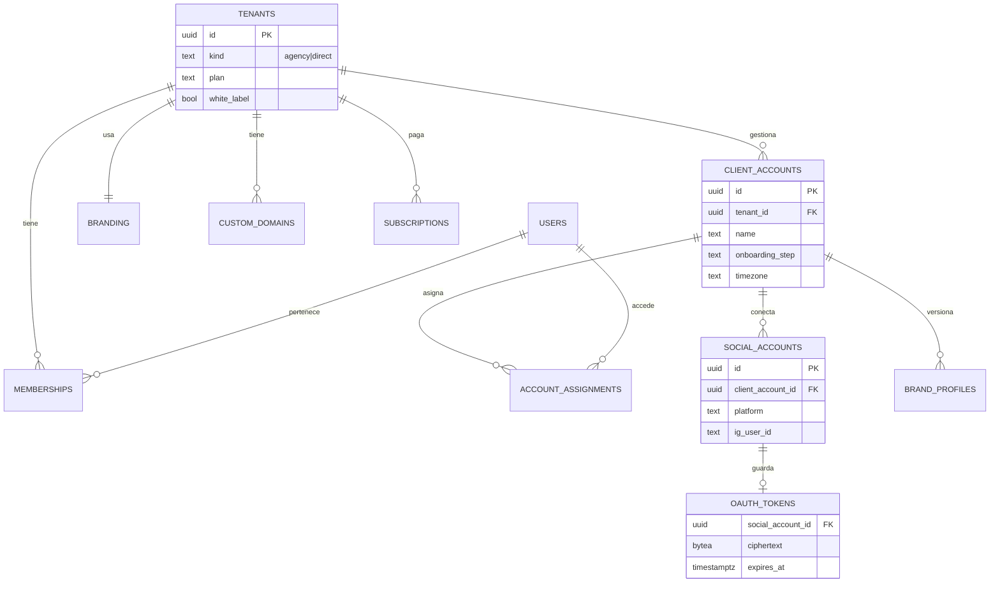
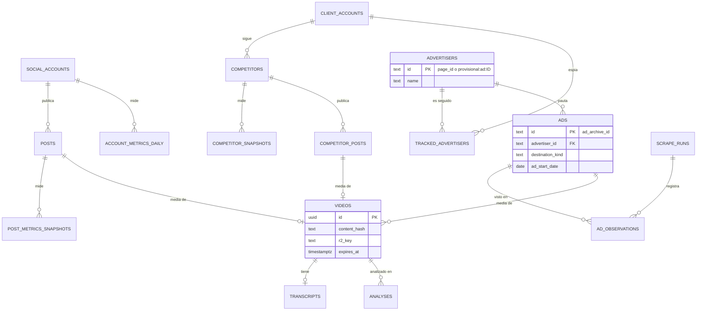
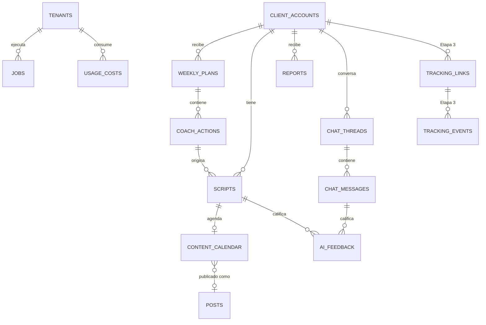

# Modelo de datos (Postgres + Drizzle)

> Relacionados: [ADR 0002 Multi-tenant](adr/0002-multi-tenant-marca-blanca.md) · [Arquitectura general](arquitectura-general.md) · [Reutilización del scrapper](reutilizacion-del-scrapper.md) · [Privacidad de datos](../03-meta-y-legal/privacidad-datos.md)

Convenciones:

- PK `id uuid default gen_random_uuid()` salvo que se indique otra cosa. Timestamps `timestamptz` (`created_at`, `updated_at`).
- **Toda tabla con datos de un tenant lleva `tenant_id`** (denormalizado, aunque se pueda inferir por FK) para RLS e índices.
- Tablas marcadas **🌐 global** guardan datos públicos compartidos (sin `tenant_id`, sin RLS de tenant; solo lectura para `app_user`).
- Enums como `text` + `check` (más fácil de migrar que los enums de Postgres).
- Nombres en inglés en el código y la DB; la UI está en español.
- Schema en `packages/db/src/schema/*.ts` (Drizzle); policies RLS en `packages/db/sql/rls/*.sql` (migraciones SQL a mano).

---

## 1. Diagramas ER

### 1.1 Tenancy, usuarios y billing



### 1.2 Contenido, competencia, anuncios y video



### 1.3 AI, planificación y operación



---

## 2. Tablas

### 2.1 Tenancy y usuarios

| Tabla | Columnas principales | Notas |
|---|---|---|
| `tenants` | `id`, `name`, `kind` (`agency`/`direct`), `white_label bool`, `plan` (`agency_starter`/`agency_pro`/`agency_scale`/`solo`/`pro`), `status` (`trial`/`active`/`past_due`/`canceled`), `founders_discount_pct`, `default_social_account_id` (nullable), `created_at` | Unidad de billing y de marca |
| `users` | `id` (= `auth.users.id` de Supabase), `email`, `name`, `locale` (default `es-419`), `last_seen_at` | Sin `tenant_id`: un usuario puede estar en varios tenants |
| `memberships` | `id`, `tenant_id`, `user_id`, `role` (`agency_owner`/`agency_member`/`client_viewer`), `invited_by`, `accepted_at` | `unique(tenant_id, user_id)` |
| `account_assignments` | `tenant_id`, `user_id`, `client_account_id` | Qué cuentas ve un `agency_member` o un `client_viewer`. PK compuesta |
| `client_accounts` (= workspace) | `id`, `tenant_id`, `name`, `slug`, `timezone`, `country`, `onboarding_step`, `status` (`active`/`paused`/`archived`), `client_chat_mode` (`off`/`read`/`full`), `activated_at` | Unidad de límite del plan |
| `branding` | `tenant_id` (PK), `product_name`, `logo_url`, `favicon_url`, `primary_color`, `secondary_color`, `email_from_name`, `email_from_domain`, `report_footer` | 1:1 con tenant |
| `custom_domains` | `id`, `tenant_id`, `host` (unique), `status` (`pending`/`verified`/`failed`), `vercel_domain_id`, `verified_at` | Resolución del tenant por host |
| `subscriptions` | `id`, `tenant_id`, `provider` (`stripe`/`mercadopago`), `provider_customer_id`, `provider_subscription_id`, `plan`, `included_accounts`, `extra_accounts`, `status`, `current_period_end`, `setup_fee_paid` | Fuente: webhooks del proveedor |
| `audit_log` | `id`, `tenant_id`, `user_id`, `action`, `target_type`, `target_id`, `meta jsonb`, `created_at` | Acciones sensibles (conectar/desconectar, roles, borrar datos) |

### 2.2 Cuentas sociales y tokens

| Tabla | Columnas principales | Notas |
|---|---|---|
| `social_accounts` | `id`, `tenant_id`, `client_account_id`, `platform` (`instagram`/`facebook`), `ig_user_id`, `fb_page_id`, `username`, `account_type` (`BUSINESS`/`MEDIA_CREATOR`), `followers_count`, `status` (`connected`/`expired`/`revoked`/`error`), `connected_by`, `last_ingest_at`, `ingest_cursor` | `unique(tenant_id, ig_user_id)` |
| `oauth_tokens` | `social_account_id` (PK), `tenant_id`, `token_type` (`user_long`/`page`), `ciphertext bytea`, `iv bytea`, `auth_tag bytea`, `dek_id`, `scopes text[]`, `expires_at`, `last_validated_at` | **Sin SELECT para `app_user`**: solo el rol `app_worker` y funciones `security definer` pueden leerla. Nunca se devuelve al cliente |
| `tenant_keys` | `id`, `tenant_id`, `encrypted_dek`, `kek_version`, `created_at`, `rotated_at` | Envelope encryption |

### 2.3 Contenido propio (M3)

| Tabla | Columnas principales | Notas |
|---|---|---|
| `posts` | `id`, `tenant_id`, `client_account_id`, `social_account_id`, `ig_media_id` (unique por social account), `media_type` (`REEL`/`CAROUSEL_ALBUM`/`IMAGE`/`VIDEO`), `caption`, `permalink`, `posted_at`, `thumbnail_url`, `media_url_expires_at`, `classification jsonb` (formato, tema, tipo de hook: Haiku), `video_id` (FK nullable) | |
| `post_metrics_snapshots` | `id`, `tenant_id`, `post_id`, `captured_at`, `age_bucket` (`d1`/`d3`/`d7`/`d30`/`daily`), `reach`, `views`, `likes`, `comments`, `saves`, `shares`, `total_interactions`, `raw jsonb` | Append-only. Particionada por mes cuando pase ~10M filas ⚠️ |
| `account_metrics_daily` | `tenant_id`, `social_account_id`, `date`, `followers`, `reach`, `views`, `profile_views`, `website_clicks`, `raw jsonb` | PK (`social_account_id`, `date`) |

### 2.4 Competencia orgánica (M4)

| Tabla | Columnas principales | Notas |
|---|---|---|
| `competitors` | `id`, `tenant_id`, `client_account_id`, `ig_username`, `ig_user_id` (de Business Discovery), `display_name`, `status` (`active`/`not_business`/`not_found`/`removed`), `added_by`, `last_snapshot_at` | `unique(client_account_id, ig_username)`. Límite por plan |
| `competitor_snapshots` | `id`, `tenant_id`, `competitor_id`, `captured_on date`, `followers_count`, `follows_count`, `media_count`, `avg_engagement_30d` (calculado) | Un registro diario. `unique(competitor_id, captured_on)` |
| `competitor_posts` | `id`, `tenant_id`, `competitor_id`, `ig_media_id`, `media_type`, `caption`, `permalink`, `posted_at`, `like_count` (nullable si está oculto), `comments_count`, `media_url`, `engagement_rate` (interacciones / seguidores al momento), `outlier_score` (vs. promedio del competidor), `classification jsonb`, `video_id`, `last_seen_at` | Upsert por `(competitor_id, ig_media_id)`; métricas actualizadas en cada snapshot durante 30 días |

### 2.5 Anuncios (M5)

| Tabla | Columnas principales | Notas |
|---|---|---|
| `advertisers` 🌐 | `id text` (PK: `page_id` de Meta, o `provisional:ad:<adId>`, igual que hoy en `src/normalize.ts`), `meta_page_id` (nullable), `name`, `first_seen_at`, `last_seen_at`, `active_ads_count` | Port de la tabla `advertisers` del SQLite |
| `ads` 🌐 | `id text` (PK: `ad_archive_id`), `advertiser_id`, `advertiser_name`, `description`, `title`, `cta_text`, `cta_url`, `destination_kind` (`website`/`whatsapp`/`messenger`/`instagram`/`internal`/`unknown`, de `classifyDestination()`), `library_url`, `country`, `platforms text[]`, `display_format` (`VIDEO`/`IMAGE`/`CAROUSEL`/`DCO` ⚠️), `ad_start_date`, `ad_end_date`, `ad_status`, `collation_count` ⚠️, `quality` (`valid`/`partial`/`invalid`), `quality_reason`, `first_seen_at`, `last_seen_at`, `longevity_days` (generada) | Port de `ads` + campos de media nuevos. Ver [gaps](reutilizacion-del-scrapper.md#4-gaps-y-cómo-cerrarlos) |
| `ad_media` 🌐 | `id`, `ad_id`, `kind` (`image`/`video`), `source_url`, `r2_key`, `width`, `height`, `video_id` (FK), `position` (carrusel) | La media se descarga apenas se scrapea (las URLs de CDN expiran) |
| `ad_observations` 🌐 | `ad_id`, `scrape_run_id`, `observed_at`, `is_active` | Historial: cuándo se vio cada anuncio (generaliza `observations` del SQLite) |
| `scrape_runs` 🌐 | `id`, `kind` (`advertiser`/`query`), `target` (page_id o query normalizada), `country`, `status` (mismo enum `Status` de `src/types.ts`), `reason`, `ads_seen`, `ads_new`, `bytes_proxy`, `started_at`, `finished_at`, `checkpoint jsonb` | Reemplaza `jobs` + `checkpoints` + `record_errors` del SQLite |
| `tracked_advertisers` | `id`, `tenant_id`, `client_account_id`, `advertiser_id` (FK 🌐), `label`, `frequency` (`daily`/`weekly`), `added_by`, `created_at` | Lo que conecta datos globales con un tenant |
| `tracked_ad_searches` | `id`, `tenant_id`, `client_account_id`, `query`, `country`, `normalized_url` (vía `validateSearchUrl()`), `frequency` | Búsquedas por palabra clave |

### 2.6 Video, transcripción y análisis (M6)

| Tabla | Columnas principales | Notas |
|---|---|---|
| `videos` | `id`, `content_hash` (sha256, **unique**), `source_kind` (`own`/`competitor`/`ad`/`upload`), `duration_s`, `r2_key`, `size_bytes`, `status` (`pending`/`downloaded`/`transcribed`/`analyzed`/`expired`/`error`), `expires_at`, `tenant_id` (**nullable**: null para media de anuncios públicos; obligatorio para `own`/`upload`) | Dedupe por hash: el mismo Reel no se transcribe dos veces |
| `transcripts` | `id`, `video_id` (unique), `provider`, `language`, `text`, `words jsonb` (timestamps), `confidence`, `cost_usd` | Se conserva aunque el video expire |
| `analyses` (insights) | `id`, `tenant_id`, `client_account_id`, `subject_type` (`video`/`post`/`competitor`/`advertiser`/`account`), `subject_id`, `agent` (`content_analyst`/`competitor_radar`/`ads_analyst`), `kind` (`video_breakdown`/`post_classification`/`weekly_competitor_summary`/`ad_angles`…), `model`, `prompt_version`, `output jsonb` (validado con zod), `score numeric`, `created_at` | Los análisis son **por tenant** (usan el Perfil de Marca), aunque el video sea global |

**`analyses.output` para `video_breakdown`** (resumen del schema):

```json
{
  "hook": { "text": "...", "type": "pregunta_incomoda|mito|resultado|historia|contraintuitivo|lista", "start_s": 0, "end_s": 2.8, "score": 8, "why": "..." },
  "promise": "...",
  "angle": "...",
  "structure": [{ "beat": "problema", "start_s": 3, "end_s": 10, "summary": "..." }],
  "cta": { "text": "...", "type": "whatsapp_keyword|link_bio|comentar|seguir|dm", "start_s": 38 },
  "emotions": ["curiosidad", "alivio"],
  "format": { "style": "talking_head", "on_screen_text": true, "pace": "rápido" },
  "replicable_pattern": "..."
}
```

### 2.7 Perfil de Marca, Coach, guiones y calendario (M1, M7, M8, M9)

| Tabla | Columnas principales | Notas |
|---|---|---|
| `brand_profiles` | `id`, `tenant_id`, `client_account_id`, `version int`, `is_current bool`, `niche`, `offer jsonb` (producto, precio, formato, canal de venta), `avatar jsonb`, `promise`, `tone jsonb` (registro: voseo/tuteo, estilo, palabras típicas), `banned_words text[]`, `claims_policy text`, `goals jsonb`, `notes`, `created_by` (`user`/`ai`) | Versionado: nunca se pisa; el agente lee `is_current` |
| `weekly_plans` | `id`, `tenant_id`, `client_account_id`, `week_start date`, `diagnosis text`, `kpis jsonb`, `model`, `prompt_version`, `status` (`draft`/`published`), `generated_at` | `unique(client_account_id, week_start)` |
| `coach_actions` | `id`, `tenant_id`, `weekly_plan_id`, `position` (1–3, o > 3 para "más ideas"), `title`, `rationale`, `evidence jsonb` (lista de `{type, id}`), `effort` (`low`/`medium`/`high`), `expected_impact`, `status` (`proposed`/`accepted`/`done`/`dismissed`), `outcome jsonb` | La evidencia apunta a IDs reales |
| `scripts` | `id`, `tenant_id`, `client_account_id`, `coach_action_id` (nullable), `origin` (`coach_action`/`chat`/`manual`), `title`, `format` (`reel`/`tiktok`/`story`/`carousel`), `target_duration_s`, `content jsonb` (hook, variantes, beats, CTA, texto en pantalla, tomas), `references jsonb`, `status` (`draft`/`approved`/`recorded`/`published`/`rejected`), `approved_by`, `approved_at`, `model`, `prompt_version`, `parent_script_id` (reescrituras), `edit_distance_pct` | La North Star sale de acá |
| `content_calendar` | `id`, `tenant_id`, `client_account_id`, `script_id` (nullable), `scheduled_for date`, `slot` (`am`/`pm`), `format`, `status` (`idea`/`scripted`/`recorded`/`published`), `post_id` (nullable: vínculo al post publicado), `notes` | |
| `reports` | `id`, `tenant_id`, `client_account_id`, `period_start`, `period_end`, `status` (`building`/`ready`/`sent`/`error`), `pdf_r2_key`, `web_token_hash`, `agency_comment`, `recipients text[]`, `sent_at`, `opened_at` | |

### 2.8 Chat y feedback

| Tabla | Columnas principales | Notas |
|---|---|---|
| `chat_threads` | `id`, `tenant_id`, `client_account_id`, `user_id`, `kind` (`onboarding`/`coach`/`general`), `title`, `summary` (compactación propia), `created_at`, `last_message_at` | |
| `chat_messages` | `id`, `tenant_id`, `thread_id`, `role` (`user`/`assistant`/`tool`), `content jsonb` (bloques de la API, incluidos `tool_use`/`tool_result`), `ui_blocks jsonb` (tarjetas, quick replies), `agent`, `model`, `input_tokens`, `output_tokens`, `cache_read_tokens`, `latency_ms`, `created_at` | Se guarda el contenido completo para poder reenviarlo (incluye bloques de thinking si los hay) |
| `ai_feedback` | `id`, `tenant_id`, `user_id`, `target_type` (`message`/`script`/`coach_action`/`analysis`), `target_id`, `rating` (`up`/`down`), `reason_tag`, `comment`, `prompt_version`, `created_at` | Alimenta los evals |

### 2.9 Operación y costos

| Tabla | Columnas principales | Notas |
|---|---|---|
| `jobs` | `id`, `tenant_id` (nullable para jobs globales), `client_account_id`, `queue`, `bullmq_job_id`, `kind`, `status` (`queued`/`running`/`completed`/`failed`/`partial`), `progress jsonb`, `attempts`, `error_reason` (saneado), `started_at`, `finished_at` | Espejo de BullMQ para la UI y el soporte |
| `usage_costs` | `id`, `tenant_id`, `client_account_id`, `kind` (`llm`/`transcription`/`proxy`/`storage`/`email`), `provider`, `model`, `agent`, `module` (`M3`…`M10`), `input_tokens`, `output_tokens`, `cache_read_tokens`, `cache_write_tokens`, `units` (minutos, GB, emails), `cost_usd numeric(10,6)`, `is_batch bool`, `ref_type`, `ref_id`, `created_at` | **Fuente de verdad del costo variable**. Costos de proxy de scrapes globales se prorratean por cuenta que sigue al anunciante |
| `plan_limits` | `plan` (PK), `max_accounts`, `max_competitors_per_account`, `max_tracked_advertisers_per_account`, `video_minutes_per_account_month`, `chat_messages_per_account_month`, `scrape_frequency` | Config, no datos de tenant |

### 2.10 Tracking (Etapa 3, M12; se reserva el diseño)

| Tabla | Columnas principales | Notas |
|---|---|---|
| `tracking_links` | `id`, `tenant_id`, `client_account_id`, `script_id`/`post_id`, `slug` (unique), `destination_url`, `utm jsonb`, `created_at` | Links cortos por contenido |
| `tracking_events` | `id`, `tenant_id`, `client_account_id`, `kind` (`click`/`lead`/`purchase`/`refund`), `source` (`link`/`hotmart`/`kiwify`/`stripe`/`mercadopago`/`whatsapp`), `tracking_link_id`, `amount`, `currency`, `external_id` (idempotencia), `attributed_post_id`, `occurred_at`, `payload_hash` | Sin PII del comprador más allá de lo necesario. Ver [tracking](../06-tracking/tracking-infoproductores.md) |

---

## 3. Índices principales

| Tabla | Índice | Para |
|---|---|---|
| todas las tenant-scoped | `(tenant_id, client_account_id, …)` como prefijo | RLS + listados por cuenta |
| `posts` | `unique(social_account_id, ig_media_id)`; `(client_account_id, posted_at desc)` | Upsert de ingesta; feed |
| `post_metrics_snapshots` | `(post_id, captured_at desc)`; BRIN en `captured_at` | Curvas y retención |
| `competitor_posts` | `unique(competitor_id, ig_media_id)`; `(client_account_id, outlier_score desc, posted_at desc)` | "Top de la competencia" |
| `competitor_snapshots` | `unique(competitor_id, captured_on)` | Serie diaria |
| `ads` 🌐 | `(advertiser_id, last_seen_at desc)`; `(destination_kind)`; `(ad_start_date)` | Feed de anunciante, filtros, longevidad |
| `ad_observations` 🌐 | `(ad_id, observed_at desc)` | Historial |
| `tracked_advertisers` | `unique(client_account_id, advertiser_id)`; `(advertiser_id)` | Dedupe de scrapes: "¿quién sigue a este anunciante?" |
| `videos` | `unique(content_hash)`; `(expires_at) where status <> 'expired'` | Dedupe; housekeeping del TTL |
| `analyses` | `(subject_type, subject_id, kind)`; `(client_account_id, created_at desc)` | |
| `scripts` | `(client_account_id, status, approved_at desc)` | North Star |
| `chat_messages` | `(thread_id, created_at)` | |
| `usage_costs` | `(tenant_id, created_at)`; `(client_account_id, created_at)` | Dashboards de costo |
| `jobs` | `(tenant_id, status, created_at desc)` | Soporte |
| `custom_domains` | `unique(host)` | Middleware |

---

## 4. RLS

### 4.1 Contexto por transacción

```sql
-- Se setea en cada transacción desde packages/db (helper withTenant)
select set_config('app.tenant_id', $1, true);
select set_config('app.user_id',   $2, true);

create function app.current_tenant() returns uuid language sql stable as
$$ select nullif(current_setting('app.tenant_id', true), '')::uuid $$;

create function app.can_access_account(acc uuid) returns boolean language sql stable security definer as $$
  select exists (
    select 1 from memberships m
    where m.tenant_id = app.current_tenant()
      and m.user_id = nullif(current_setting('app.user_id', true), '')::uuid
      and (m.role = 'agency_owner'
           or exists (select 1 from account_assignments a
                      where a.user_id = m.user_id and a.client_account_id = acc))
  ) $$;
```

### 4.2 Policies tipo

```sql
alter table scripts enable row level security;
alter table scripts force row level security;

create policy tenant_isolation on scripts
  using (tenant_id = app.current_tenant() and app.can_access_account(client_account_id))
  with check (tenant_id = app.current_tenant() and app.can_access_account(client_account_id));
```

| Tipo de tabla | Policy |
|---|---|
| Tenant-scoped con cuenta (`posts`, `scripts`, `competitors`, …) | `tenant_id = current_tenant()` **y** `can_access_account(client_account_id)` |
| Tenant-scoped sin cuenta (`branding`, `subscriptions`, `usage_costs`) | `tenant_id = current_tenant()` + rol (`agency_owner` para billing y costos) |
| `oauth_tokens`, `tenant_keys` | Sin policies para `app_user` (deny total). Solo `app_worker` |
| 🌐 globales (`ads`, `advertisers`, `ad_media`, `ad_observations`, `scrape_runs`) | `app_user`: solo `SELECT`. Escritura: solo `app_worker` |
| `client_viewer` | Además, se le excluyen columnas internas vía vistas (`scripts_client_view`) y nunca ve `audit_log`, `usage_costs` ni notas internas |

### 4.3 Roles de base de datos

| Rol | Usado por | BYPASSRLS |
|---|---|---|
| `app_user` | `apps/web` (Drizzle con pool del servidor) | No |
| `app_worker` | `apps/worker` (setea `app.tenant_id` por job) | No (lee tokens vía funciones `security definer`) |
| `app_maintenance` | Housekeeping, migraciones | Sí (auditado, solo jobs internos) |
| — | `apps/scraper-worker` | **Sin acceso a la DB** |

Tests obligatorios en CI (`packages/db/test/rls.test.ts`): por cada tabla tenant-scoped, un usuario del tenant A no puede leer, insertar ni actualizar filas del tenant B, y un `client_viewer` no ve cuentas no asignadas.

---

## 5. Retención de datos

| Dato | Retención | Mecanismo |
|---|---|---|
| Videos (MP4) en R2 | **30 días** ⚠️ desde la descarga | Regla de lifecycle de R2 + `housekeeping` marca `expired` |
| Transcripts y análisis | Mientras exista la cuenta cliente | Borrado en cascada al eliminar la cuenta |
| `post_metrics_snapshots` | Detalle 180 días; después solo d1/d7/d30 + agregados semanales | Job mensual de compactación |
| `competitor_snapshots` | 24 meses | Job mensual |
| `ad_observations` 🌐 | 12 meses de detalle; después, solo `first_seen`/`last_seen` en `ads` | Job mensual |
| Media de anuncios 🌐 | 90 días ⚠️ (o mientras algún tenant siga al anunciante) | Lifecycle de R2 |
| `chat_messages` | 12 meses (después, `summary` en el thread) | Job mensual |
| `jobs` | 90 días | Job semanal |
| `usage_costs` | 24 meses (contable) | — |
| `audit_log` | 24 meses | — |
| `oauth_tokens` | Hasta la desconexión, revocación o data deletion callback → **borrado inmediato** | Webhook de Meta + acción del usuario |
| Datos de un tenant cancelado | 30 días de gracia → borrado total (excepto facturación) | Job + checklist de [privacidad](../03-meta-y-legal/privacidad-datos.md) |
| `tracking_events` (Etapa 3) | 24 meses | — |

**Data deletion callback de Meta:** al recibirlo se borran `oauth_tokens`, `posts`, `post_metrics_snapshots`, `account_metrics_daily` y los análisis derivados de esa `social_account`, y se devuelve un `confirmation_code` con URL de estado. Ver [App Review](../03-meta-y-legal/meta-app-review-y-permisos.md).

---

## 6. Mapeo desde el SQLite actual del scrapper

| SQLite (`src/storage.ts`) | Postgres | Comentario |
|---|---|---|
| `advertisers` | `advertisers` 🌐 | Mismo criterio de ID (`page_id` o `provisional:ad:<id>`) |
| `ads` (+ `meta_page_id`, `meta_page_id_source`) | `ads` 🌐 | Se suman `title`, `display_format`, `ad_end_date`, media |
| `observations` | `ad_observations` 🌐 | Ahora referencia `scrape_run_id` |
| `jobs`, `checkpoints`, `record_errors`, `job_leases` | `scrape_runs` + BullMQ | El lease pasa a ser el lock de BullMQ; el checkpoint, un `jsonb` |
| `prospecting_databases`, `database_ads`, `database_advertisers` | `tracked_advertisers` / `tracked_ad_searches` | Las "bases" lógicas se reemplazan por el seguimiento por cuenta cliente |
| `searches` | `tracked_ad_searches.normalized_url` | |
| `exports` | (no aplica) | Export CSV on-demand desde la UI |
| `settings`, `schema_migrations` | Migraciones Drizzle | |
