# Reutilización del scrapper (`scrapper-meta-pro` → `packages/meta-ads-scraper`)

> Relacionados: [ADR 0003 Scrapper como worker](adr/0003-scrapper-como-worker.md) · [Modelo de datos](modelo-de-datos.md#25-anuncios-m5) · [Arquitectura general](arquitectura-general.md) · [Ads Library y scraping](../03-meta-y-legal/ads-library-y-scraping.md) · [Proxies](../03-meta-y-legal/proxies.md) · [Sprint 3](../08-scrum/sprints/sprint-03.md)

## 1. Qué tenemos hoy

CLI local "JederTech Meta Scraper": **~2.800 líneas de TS** en `src/` + **~1.500 líneas de tests** en `tests/` (`node:test`, sin framework extra). TypeScript 5.9 strict ESM, Node ≥ 22.13 (`node:sqlite`), Playwright 1.61.1 (Chromium).

```
CLI/menú → Playwright → JSON GraphQL + tarjetas DOM → normalize() → SQLite (persistBatch) → CSV
```

| Fortaleza (se conserva) | Limitación (hay que resolver) |
|---|---|
| Intercepta `/api/graphql/` (`AdLibrarySearchPaginationQuery`) y parsea respuestas multilínea `for(;;);` | Pensado para uso **interactivo** (sesión visible, `+N`, `r`, `q`) |
| Fallback DOM robusto (`parseVisibleCard`, `LABEL_PATTERN` en español e inglés) | Persistencia en `node:sqlite` local (`data/meta-scraper.sqlite`) |
| Circuit breaker de errores GraphQL (`GraphqlHealth`: aviso al 3.º, pausa al 5.º) | Perfiles de navegador en disco (`profiles/`) |
| Parada segura en 403/429 (`AccessError`, estados `ACCESS_DENIED`/`RATE_LIMITED`) | Sin proxies |
| Dedupe por `ad_id`, identidades provisionales de anunciante, checkpoints, lotes de 100 | No captura imágenes, videos, título ni formato |
| Pruning del DOM para scrapes largos sin agotar la memoria | Sin concurrencia (un proceso, un navegador, con lock) |
| Stealth (`browser-compat.ts`): UA real, flags, init script | Sin seguimiento temporal explícito de anunciantes |
| Más de 100 tests con escenarios HTTP reales simulados (`browserTypes` inyectables) | |

---

## 2. Mapa archivo por archivo

Leyenda: ✅ **Reutilizar tal cual** · 🔧 **Adaptar** · ❌ **Descartar** (en el SaaS; puede seguir viviendo en este repo como herramienta interna)

| Archivo | Líneas | Qué hace | Veredicto | Destino / cambios |
|---|---|---|---|---|
| `src/types.ts` | 41 | `Ad`, `ExtractBatch`, `Extractor`, `Status`, `Quality`, `AccessError` | 🔧 | `packages/meta-ads-scraper/src/types.ts`. Extender `Ad` con `title`, `displayFormat`, `media[]`, `adEndDate`, `isActive`, `collationCount` ⚠️. `Status` se mantiene (lo usa `scrape_runs.status`) |
| `src/normalize.ts` | 38 | `normalize(raw, method, country)` → `Ad` con `quality` y `qualityReason`; IDs provisionales `provisional:ad:<id>` | ✅ + extensión | Mantener la lógica de IDs y calidad; agregar el mapeo de los campos de media |
| `src/extractors.ts` | 856 | **Motor**: `PlaywrightExtractor.iterate()`, `parseJsonAds()`, `collectAds()`, `shouldCaptureResponse()`, `graphqlErrorDetail()`, `scrollBudgetForTarget()`, pausas humanas | 🔧 (núcleo) | Conservar `parseJsonAds`/`collectAds`/`shouldCaptureResponse`/`graphqlErrorDetail` **sin cambios de comportamiento**. En `collectAds()` sumar `snapshot.title`, `snapshot.images`, `snapshot.videos`, `snapshot.cards`, `snapshot.display_format`, `end_date`/`is_active` ⚠️. En `ExtractorOptions` agregar `proxy`, `blockHeavyResources`, `captureMedia`. En servidor: `headless: true` siempre, sin `profileDir`, `keepOpen` ni `persistentSession` |
| `src/browser-compat.ts` | 58 | Stealth: `stealthContextOptions()`, `stealthLaunchOptions()`, `stealthInitScript`, UA Chrome 149 | ✅ | Igual. Agregar un test que alerte si la versión del UA queda vieja respecto del Chromium de Playwright. `locale` configurable (`es-AR`, `es-MX`…) según el país |
| `src/dom-inspection.ts` | 196 | `inspectLoadedPage()`, `pruneVisibleCards()`, `LABEL_PATTERN` | ✅ | Igual (el pruning es clave en headless con poca RAM) |
| `src/visible-card.ts` | 30 | `parseVisibleCard()` (fallback DOM) | ✅ | Igual |
| `src/pagination.ts` | 27 | `selectMoreButton()`, `stopReason()` | ✅ | Igual |
| `src/graphql-health.ts` | 21 | `GraphqlHealth` (racha de errores) | ✅ | Igual. `manualResume()` deja de usarse (no hay operador): en servidor, `shouldPause` ⇒ terminar el job con `GRAPHQL_ERROR` |
| `src/progress-wait.ts` | 28 | `waitForActivity()` (espera acotada) | ✅ | Igual |
| `src/diagnostics.ts` | 44 | `DiagnosticEvent`, `safeDiagnosticUrl()`, `errorKind()`, `exitCodeForStatus()` | 🔧 | Conservar eventos y saneo de URLs → enviarlos a logs estructurados/Sentry. `exitCodeForStatus()` ❌ |
| `src/security.ts` | 37 | `validateSearchUrl()`, `validateRedirect()`, `safeHttpUrl()`, `redact()`, `safeName()` | ✅ | Igual. `redact()` también se reutiliza en el logger del SaaS. `safeName()` solo si hace falta |
| `src/destination.ts` | 15 | `classifyDestination()` → `website`/`whatsapp`/`messenger`/`instagram`/`internal`/`unknown` | ✅ | Igual; se calcula al persistir (`ads.destination_kind`). Insight clave para infoproductores (embudo a WhatsApp) |
| `src/browser-health.ts` | 58 | `BrowserHealth` (snapshot de proceso, contexto, página, GraphQL) | 🔧 | Reusar como fuente de métricas del job (`scrape_runs.checkpoint`, logs) |
| `src/runner.ts` | 71 | `runJob()`: lease, buffer `FLUSH_BATCH_SIZE=100`, mapeo de errores a `Status` | 🔧 | Se convierte en `scrapeAds()`: misma lógica de buffer/flush y mapeo de estados, pero emitiendo lotes a un `AdSink` en lugar de `Storage.persistBatch()`. El lease lo reemplaza el lock de BullMQ |
| `src/storage.ts` | 249 | SQLite: migraciones, `persistBatch()`, `filterNewAds()`, `baseAdRows()`, leases, backups | 🔧 (reescritura) | La **semántica** se porta a Postgres/Drizzle en `apps/worker` (no en el paquete): upsert idempotente de `ads`/`advertisers`, promoción de identidad provisional → `meta_page_id`, conflicto de IDs sin contaminar, `ad_observations`. `filterNewAds()` → consulta batch a Postgres (o un Set de Redis por run) inyectada como `ExtractorOptions.filterNewAds` |
| `src/exporter.ts` | 76 | CSV con protección contra fórmulas (`cell()`), escritura atómica | 🔧 | Reutilizar `cell()`/`csv()` y las columnas para "Exportar CSV" en M5 (streaming HTTP). La escritura en disco ❌ |
| `src/session-runner.ts` | 67 | `runSessionSlice()` para sesión interactiva | ❌ | Su idea útil (confirmar el lote pendiente tras interrupción) ya está en `runner.ts` |
| `src/session-cli.ts` | 230 | Sesión persistente visible con teclas | ❌ | Herramienta de operador local; queda en este repo |
| `src/session-lock.ts` | 20 | Lock de sesión de navegador | ❌ | BullMQ + 1 navegador por proceso |
| `src/browser-profiles.ts` | 94 | Perfiles `main`/`temp` en disco | ❌ | En servidor: contexto efímero por job (sin cookies persistentes) |
| `src/cli.ts`, `src/wizard.ts`, `src/wizard-choices.ts` | 462 | CLI y menú interactivo | ❌ | Se mantienen en este repo para debug manual |
| `src/progress.ts` | 60 | Líneas de progreso en la terminal | ❌ | Progreso → `jobs.progress` + eventos realtime |
| `src/project-format.ts` | 41 | Formatear el proyecto local | ❌ | |
| `scripts/probe41/*`, `scripts/needs-build.mjs` | — | Utilidades locales | ❌ | |
| `install.sh`, `jedertech.sh`, `meta-scraper` | — | Lanzadores locales | ❌ | Dockerfile en `apps/scraper-worker` |

**Resumen:** ~60% del código se reutiliza tal cual o con cambios menores (todo el "cerebro" de extracción y parseo); ~25% se adapta (runner, storage, diagnóstico, export) y ~15% se descarta (UX interactiva de terminal).

---

## 3. Diseño del paquete

```
packages/meta-ads-scraper/
├── src/
│   ├── index.ts              export { scrapeAds, type ScrapeInput, type ScrapeResult, type AdSink }
│   ├── scrape.ts             (ex runner.ts) orquesta extractor + buffer + estados
│   ├── extractors.ts         (portado) PlaywrightExtractor
│   ├── parse/                collectAds, parseJsonAds, visible-card, normalize
│   ├── browser/              browser-compat, dom-inspection, pagination, progress-wait, graphql-health
│   ├── media.ts              NUEVO: extracción de URLs de media del snapshot
│   ├── destination.ts, security.ts, diagnostics.ts, types.ts
│   └── url.ts                NUEVO: buildAdvertiserUrl(pageId, country), buildSearchUrl(q, country)
├── test/                     tests portados (node:test) + fixtures GraphQL reales anonimizadas
└── package.json              deps: playwright (versión fija). SIN drizzle, SIN bullmq
```

```ts
// API pública (sin dependencias de DB ni de colas)
export interface ScrapeInput {
  url: string;                 // validada con validateSearchUrl()
  mode: 'ads' | 'advertisers';
  limit: number;               // tope de anuncios del job
  country: string | null;
  captureMedia: boolean;
}
export interface AdSink {
  filterNew(ids: string[]): Promise<string[]>;            // dedupe externo (ex filterNewAds)
  persist(batch: Ad[], cursor: string | null): Promise<void>;
}
export interface ScrapeResult { status: Status; reason: string; adsSeen: number; adsNew: number; bytes: number }
export function scrapeAds(input: ScrapeInput, deps: { sink: AdSink; signal: AbortSignal; proxy?: ProxyConfig; onEvent?: (e: DiagnosticEvent) => void }): Promise<ScrapeResult>;
```

> Nota: hoy `ExtractorOptions.filterNewAds` es **síncrono** (`(ids) => string[]`) porque `node:sqlite` es síncrono. Con Postgres hay que pasarlo a `async`, o resolver el dedupe por run con un `Set` en memoria precargado + verificación final en el sink. Es el cambio más delicado del port: cubrirlo con los tests de dedupe existentes.

### Job en `apps/scraper-worker`

```ts
new Worker('scrape:ads', async (job) => {
  const { url, limit, country, captureMedia, runId } = ScrapeJobSchema.parse(job.data);
  const sink = queueSink(runId);           // publica lotes en 'scrape:results' (no toca la DB)
  return scrapeAds({ url, mode: 'ads', limit, country, captureMedia }, {
    sink, signal: abortFromJob(job), proxy: pickProxy(country),
  });
}, { connection, concurrency: 1, lockDuration: 10 * 60_000 });
```

El worker principal consume `scrape:results` y hace los upserts en Postgres (con la lógica portada de `Storage.persistBatch()`).

---

## 4. Gaps y cómo cerrarlos

| # | Gap | Solución propuesta | Esfuerzo | Sprint |
|---|---|---|---|---|
| G1 | **Media del snapshot** (imágenes, videos, título, formato) | Extender `collectAds()` para leer `snapshot.title`, `snapshot.link_description`, `snapshot.display_format`, `snapshot.images[].original_image_url`/`resized_image_url`, `snapshot.videos[].video_hd_url`/`video_sd_url`/`video_preview_image_url`, `snapshot.cards[]` (carruseles) ⚠️ nombres a confirmar con fixtures reales. Descargar la media **en el mismo job** (las URLs de CDN expiran) y subirla a R2 desde el worker principal (el scraper solo pasa las URLs, o sube con credenciales R2 limitadas a un bucket de "inbox") | M | S3 (URLs) · S4 (descarga + M6) |
| G2 | **Seguimiento de anunciantes en el tiempo** | Scrape por `view_all_page_id=<PAGE_ID>&active_status=active` ⚠️ por anunciante seguido; `ad_observations` por run; marcar `ad_end_date`/inactivo cuando un anuncio deja de aparecer en 2 runs seguidos; calcular `longevity_days` y "anuncios ganadores" | M | S3 |
| G3 | **Concurrencia** | 1 Chromium por proceso (≈ 1–1,5 GB RAM ⚠️), escalar con réplicas. BullMQ `concurrency: 1`, con rate limiter global (p. ej., máx. N jobs/min por IP de proxy). Dedupe: si 5 tenants siguen al mismo anunciante → 1 job (`jobId = hash(url)`) | S | S3 |
| G4 | **Proxies** | `ProxyConfig` en `launch({ proxy })`/`newContext({ proxy })` de Playwright; proveedor residencial rotativo con geo LATAM; sticky session por job; medir bytes con `request.sizes()` ⚠️ o con el reporte del proveedor. Bloquear `image`/`media`/`font` en el `page.route('**/*')` existente cuando `captureMedia=false` para ahorrar GB. En Etapa 0–1, sin proxy y con volúmenes bajos | M | S3 (hook) · S7 (proveedor) |
| G5 | **Headless en servidor** | Imagen `mcr.microsoft.com/playwright:v1.61.1-noble` ⚠️ (misma versión que el `package.json`); `headless: true`; mantener `stealthLaunchArgs` + `stealthInitScript`; `--disable-dev-shm-usage` en contenedores; timezone y locale coherentes con el proxy | S | S3 |
| G6 | **Persistencia async (Postgres)** | Ver nota de `filterNewAds` arriba; upserts idempotentes con `on conflict (id) do update set last_seen_at = …` | M | S3 |
| G7 | **Detección de cambios de Meta** | Fixtures GraphQL guardadas (anonimizadas) + test de contrato; alerta si `ads_new = 0` y `status = STALLED` en más del 30% de los runs del día ⚠️ | S | S3–S7 |
| G8 | **Respaldo externo** | Interfaz `AdsSource` (`scraper` \| `apify` ⚠️) con el mismo `Ad` normalizado | M | Etapa 2–3 |
| G9 | **Observabilidad** | `DiagnosticEvent` → logs JSON + Sentry breadcrumbs; `BrowserHealth` → métricas del run | S | S3 |
| G10 | **Spend/impresiones** | No disponibles para anuncios comerciales fuera de la UE: **no se promete** en el producto | — | — |

---

## 5. Plan de migración paso a paso

```mermaid
flowchart LR
  A[1 · Congelar y etiquetar<br/>scrapper-meta-pro v1] --> B[2 · Copiar src/ a<br/>packages/meta-ads-scraper]
  B --> C[3 · Tests verdes<br/>sin cambios]
  C --> D[4 · Extraer API pura<br/>scrapeAds + AdSink]
  D --> E[5 · Async sink<br/>+ dedupe]
  E --> F[6 · Schema Postgres<br/>+ upserts portados]
  F --> G[7 · scraper-worker<br/>Docker headless]
  G --> H[8 · Media + seguimiento<br/>G1, G2]
  H --> I[9 · Proxies + rate limit<br/>G3, G4]
  I --> J[10 · Shadow run vs CLI<br/>y go-live]
```



| Paso | Detalle | Criterio de "listo" |
|---|---|---|
| 1 | Tag `v1-cli` en `scrapper-meta-pro`; el CLI sigue disponible para uso interno | Tag creado |
| 2 | Copiar `src/*.ts` y `tests/*.mjs` al paquete, **con su historial** (`git subtree` o `git filter-repo` ⚠️) o copia simple con referencia al commit | Paquete compila en el monorepo |
| 3 | Correr los tests tal cual (`node --test`) apuntando a `dist/` del paquete | Los tests offline (`core`, `http-scenarios`, `stabilization`, `progress-wait`, `browser-health`) pasan |
| 4 | Crear `scrape.ts` desde `runner.ts` con `AdSink`; borrar los imports de CLI, sesión y perfiles | Tests del runner adaptados y verdes |
| 5 | `filterNew` async + dedupe por run | Tests de dedupe (`filterNewAds`, "runner persiste lotes en trozos de 100") verdes |
| 6 | Drizzle: `advertisers`, `ads`, `ad_media`, `ad_observations`, `scrape_runs`, `tracked_*`; portar la lógica de `persistBatch()` (identidad provisional → real, conflictos) al consumidor de `scrape:results` | Tests de integración contra Postgres (Testcontainers o Supabase local) equivalentes a "ID estructurado promueve identidad provisional…" y "conflicto entre IDs estructurados…" |
| 7 | `apps/scraper-worker` + Dockerfile + deploy aislado | Un job real de 50 anuncios termina `COMPLETED` desde Railway/Fly |
| 8 | G1 + G2 con fixtures reales | Media en R2 y `ad_observations` en 2 runs consecutivos |
| 9 | G3 + G4 | 20 anunciantes/hora sin `RATE_LIMITED` ⚠️; GB/job medidos |
| 10 | Correr en paralelo el CLI local y el worker sobre las mismas 10 búsquedas durante 1 semana | ≥ 95% de coincidencia de `ad_id` ⚠️; go-live de M5 |

---

## 6. Tests a conservar

| Archivo actual | Qué cubre | Acción |
|---|---|---|
| `tests/core.test.mjs` | URL segura, normalización (IDs grandes, Unicode, calidad), `collectAds` sobre muestras reales, multilínea GraphQL, `shouldCaptureResponse`, `parseVisibleCard`, `classifyDestination`, dedupe por base, CSV anti-fórmulas, leases, migraciones | **Conservar** la parte de parseo, normalización, seguridad y destino tal cual. Los de SQLite (bases, leases, migraciones) → reescribir como tests de integración Postgres con los **mismos casos** |
| `tests/http-scenarios.test.mjs` | 403/429 en documento y GraphQL, 404 secundario, redirecciones, timeouts, JSON inválido sin filtrar datos sensibles, cancelación previa | **Conservar íntegro** (usa `browserTypes` inyectables, sin red). Es el seguro contra regresiones del motor |
| `tests/stabilization.test.mjs` | Paginación "Ver más", DOM pruning, `GraphqlHealth` (pausa al 5.º error), identidades provisionales, chunking de 100, sesión persistente | **Conservar**: paginación, pruning, GraphQL health, identidades y chunking. **Descartar**: los de sesión interactiva (`+N`, `r`, `q`, SIGINT) |
| `tests/progress-wait.test.mjs` | Espera acotada y cancelación | Conservar |
| `tests/browser-health.test.mjs` | Snapshot de salud sin red | Conservar |
| `tests/browser-local.test.mjs` | Chromium real contra páginas locales | Conservar como test de integración del Docker (CI nocturno) |
| `tests/browser-profiles.test.mjs`, `tests/session-process.fixture.mjs` | Perfiles y proceso interactivo | Descartar en el SaaS |
| `tests/benchmark-local.mjs`, `tests/benchmark-parser.mjs` | Rendimiento con 5.000 anuncios | Conservar como benchmark manual |

**Nuevos tests a sumar:** fixtures de `snapshot` con media (G1), contrato de `ScrapeResult`, sink async con dedupe concurrente, proxy configurado en `launch`, bloqueo de recursos pesados, y el aislamiento (el paquete no importa nada de `packages/db`; verificado con una regla de lint `no-restricted-imports`).

---

## 7. Checklist del port (para el [Backlog](../08-scrum/backlog.md))

- [ ] Paquete creado con tests offline verdes.
- [ ] `scrapeAds()` + `AdSink` + `filterNew` async.
- [ ] Schema Postgres de anuncios + consumidor `scrape:results`.
- [ ] `apps/scraper-worker` deployado en infra aislada, sin acceso a la DB ni a tokens.
- [ ] Captura de media (G1) y seguimiento temporal (G2).
- [ ] Proxies opcionales por job + bloqueo de recursos (G4).
- [ ] Métricas `scrape_job_finished` + alertas.
- [ ] Shadow run de 1 semana contra el CLI.
