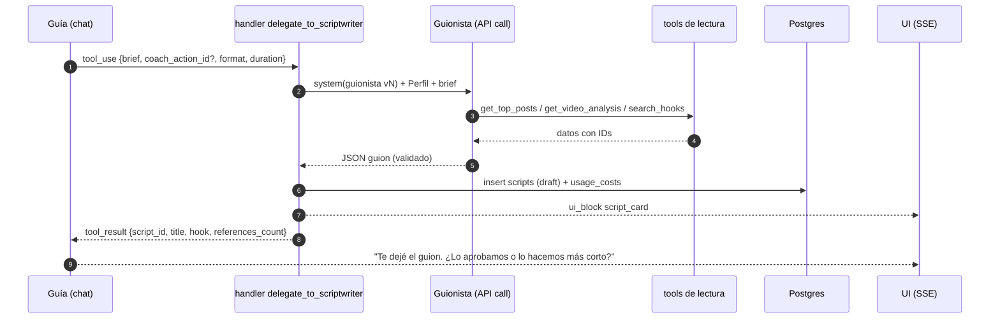
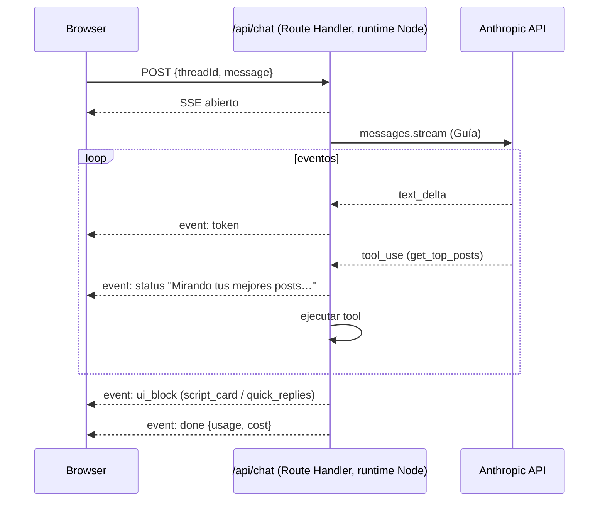

# Arquitectura multiagente de Jeder AI

> Relacionados: [Flujo guiado SIMPLE](../02-producto/flujo-guiado-simple.md) · [ADR 0004 LLM](../04-arquitectura/adr/0004-proveedor-llm-y-transcripcion.md) · [Modelo de datos](../04-arquitectura/modelo-de-datos.md) · [Costos](../04-arquitectura/costos-de-infra.md) · [Evals](evals-y-calidad.md) · Prompts: [Guía](prompts/guia.md) · [Analista](prompts/analista.md) · [Guionista](prompts/guionista.md) · [Coach](prompts/coach.md)

---

## 1. Principios

1. **Workflows primero, agentes donde hace falta.** Lo que se puede programar como pipeline (ingesta → transcribir → analizar → guardar) es código con **una** llamada al LLM por paso. El comportamiento agéntico (decidir qué tool usar) vive solo en el **chat** (Orquestador) y en la generación de guiones/planes, donde la tarea es abierta.
2. **Un orquestador, subagentes especialistas.** El usuario habla con un solo agente (el Guía). El Guía delega en especialistas con contexto acotado y tools mínimos.
3. **Los datos entran por tools, nunca de memoria.** Ninguna métrica se escribe si no salió de un tool en ese turno o de un análisis guardado con ID.
4. **Salidas estructuradas.** Todo lo que se guarda en la DB (análisis, guiones, planes) sale con JSON Schema validado (zod), no con texto libre parseado.
5. **Memoria explícita.** El "recuerdo" de cada cliente es el **Perfil de Marca** + una ficha de cuenta precalculada + el historial (guiones aprobados, feedback). Sin memoria implícita "mágica".
6. **Costo consciente.** Modelo y `effort` por tarea, prompt caching siempre, Batches para lo no urgente.

## 2. Agentes canónicos

| Agente | Módulos | Modelo | `effort` ⚠️ | Modo | Prompt |
|---|---|---|---|---|---|
| **Orquestador/Guía** | M1 (y puerta de entrada de todo el chat) | `claude-sonnet-5-5` | `low` | Agente con tools, streaming | [guia.md](prompts/guia.md) |
| **Analista de Contenido** | M3, M6 | `claude-sonnet-5-5` (análisis) · `claude-haiku-5-5` (clasificación) · `claude-opus-5-5` (profundo a pedido) | `medium` / `low` | Workflow (1 llamada, salida estructurada) + subagente | [analista.md](prompts/analista.md) |
| **Radar de Competencia** | M4 | Haiku (etiquetado) + Sonnet (resumen semanal) | `low` / `medium` | Workflow + subagente | [analista.md](prompts/analista.md) (modo `radar`) |
| **Analista de Anuncios** | M5 | Haiku (agrupado) + Sonnet (estrategia) | `low` / `medium` | Workflow + subagente | [analista.md](prompts/analista.md) (modo `anuncios`) |
| **Guionista** | M8 | `claude-sonnet-5-5` | `medium` | Subagente con tools de lectura, salida estructurada | [guionista.md](prompts/guionista.md) |
| **Coach de Crecimiento** | M7, M10 | Sonnet (semanal, vía Batches) · Opus (diagnóstico mensual) | `medium` / `high` | Workflow programado + subagente en el chat | [coach.md](prompts/coach.md) |
| **Agente de Tracking** | M12 (Etapa 3) | Sonnet + Haiku | — | Workflow | Ver [tracking](../06-tracking/tracking-infoproductores.md) |

## 3. Diagrama

```mermaid
flowchart TB
  U((Usuario)) <-->|SSE| API["/api/chat (Next.js)"]
  API <--> G["🧭 Orquestador / Guía<br/>Sonnet 5.5 · effort low"]

  subgraph Memoria["Contexto por cuenta (cacheado)"]
    BP[(Perfil de Marca<br/>brand_profiles)]
    FS[(Ficha de cuenta<br/>KPIs, top formatos)]
    TH[(Resumen del thread)]
  end
  BP --> G
  FS --> G
  TH --> G

  G -->|"tools de lectura"| RT["get_account_summary · get_top_posts<br/>get_competitor_feed · get_ads<br/>get_video_analysis · search_hooks"]
  G -->|"delegate_*"| SUB

  subgraph SUB["Subagentes (llamadas separadas, contexto acotado)"]
    AC["🔍 Analista de Contenido"]
    RC["📡 Radar de Competencia"]
    AA["🕵️ Analista de Anuncios"]
    GU["✍️ Guionista"]
    CO["📈 Coach"]
  end
  SUB --> RT
  G -->|"tools de acción (con confirmación)"| WT["save_brand_profile · add_competitors<br/>track_advertiser · save_script<br/>schedule_content · enqueue_analysis"]
  RT --> DB[(Postgres)]
  WT --> DB
  WT --> Q[(BullMQ)]

  subgraph Batch["Pipelines programados (sin chat)"]
    P1["video:analyze → Analista"] --> DB
    P2["domingo: weekly → Coach (Batches API)"] --> DB
    P3["diario: clasificar posts → Haiku"] --> DB
  end
```



## 4. Patrón orquestador → subagentes

### 4.1 Cómo delega el Guía

Los subagentes se exponen al Guía como **tools** (`delegate_to_scriptwriter`, `delegate_to_coach`, etc.). El handler del tool:

1. Arma el contexto del subagente (su system prompt + Perfil de Marca + el `brief` que mandó el Guía).
2. Hace **una llamada separada** a la API (con sus propios tools de lectura si los necesita, máx. 4 iteraciones).
3. Valida la salida con zod (structured output).
4. Guarda el resultado (p. ej., `scripts` en `draft`) y devuelve al Guía un **resumen corto + IDs**, no el objeto entero (ahorra tokens en el contexto del Guía).
5. La UI recibe el objeto completo por un canal aparte (`ui_block: script_card`).



### 4.2 Por qué no un único agente con todos los tools

| Un agente gigante | Orquestador + subagentes |
|---|---|
| System prompt enorme (todas las reglas de guiones, análisis, coach) en cada turno | Cada prompt es corto y especializado; se cachea por separado |
| 20+ tools: más errores de selección | Guía con ~10 tools; cada subagente con 3–5 |
| Difícil de evaluar | Evals por agente con su propio set |
| Cualquier cambio rompe todo | Versionado independiente (`guionista@v3` sin tocar el Guía) |

### 4.3 Cuándo NO pasar por el Guía

- Pipelines programados (análisis de cada video nuevo, plan semanal, clasificación diaria) llaman al agente **directo** desde el worker.
- Botones de la UI con intención clara ("Generar guion de esta acción") llaman al endpoint del Guionista directo; el Guía solo se entera (mensaje de sistema en el thread) para mantener la continuidad.

## 5. Tools por agente

> Todos los tools reciben el contexto (`tenantId`, `clientAccountId`, `userId`) **desde el servidor**, nunca desde el modelo. El modelo no puede pedir datos de otra cuenta.
> Tools definidos con `betaZodTool` (zod) y `strict: true`. Las respuestas de los tools son **compactas** (top N, agregados) e incluyen IDs para citar.

### 5.1 Lectura (compartidos)

| Tool | Devuelve | Lo usan |
|---|---|---|
| `get_account_summary({ period })` | KPIs (seguidores, alcance, interacciones, deltas), formato ganador, frecuencia | Guía, Coach |
| `get_top_posts({ period, metric, format?, limit≤10 })` | Posts propios con métricas + clasificación + `post_id` | Guía, Analista, Guionista, Coach |
| `get_competitor_feed({ period, competitor?, sort: 'outlier'\|'recent', limit≤10 })` | Posts de competidores con `engagement_rate`, `outlier_score` | Radar, Guionista, Coach |
| `get_competitor_overview()` | Por competidor: seguidores, delta, frecuencia, formato dominante | Radar, Coach |
| `get_ads({ advertiser?, active?, min_longevity_days?, destination_kind?, limit≤15 })` | Anuncios con texto, CTA, destino, longevidad, `ad_id` | Analista de Anuncios, Guionista, Coach |
| `get_video_analysis({ subject_type, subject_id })` | Análisis guardado (hook, beats, CTA) | Guía, Guionista |
| `search_hooks({ query?, hook_type?, source?, limit≤10 })` | Biblioteca de hooks analizados (full-text en el MVP; pgvector después ⚠️) | Guionista |
| `get_scripts({ status?, limit≤10 })` | Guiones previos (para estilo y para no repetir) | Guionista, Coach |
| `get_weekly_plan({ week? })` | Plan y acciones con estado y resultado | Guía, Coach |
| `get_brand_profile()` | Perfil vigente (normalmente ya está en el contexto cacheado) | Todos |
| `get_onboarding_state()` | Paso actual, checklist, conexiones, jobs en curso | Guía |

### 5.2 Acción (con efectos)

| Tool | Efecto | Confirmación |
|---|---|---|
| `save_brand_profile({ patch })` | Nueva versión del Perfil de Marca | Implícita (el usuario lo dictó) + resumen visible |
| `validate_instagram_handles({ handles[] })` | Llama a Business Discovery y devuelve válido / personal / no existe | No (solo lectura externa) |
| `add_competitors({ handles[] })` | Inserta competidores + encola el snapshot | **Sí** (quick reply "Confirmar") |
| `track_advertiser({ page_id \| library_url })` | `tracked_advertisers` + encola `scrape:ads` | **Sí** |
| `enqueue_analysis({ subject_type, subject_id })` | Encola `video:download`/`ai:analyze` | No (respeta las cuotas) |
| `save_script({ script })` / `update_script_status` | Guarda o cambia el estado | Aprobar = **siempre** acción del usuario (botón), nunca del modelo |
| `schedule_content({ script_id, date, slot })` | Ítem de calendario | **Sí** |
| `create_connection_link()` | Link firmado para el cliente final | No |

### 5.3 Delegación (solo el Guía)

| Tool | Subagente | Input |
|---|---|---|
| `delegate_to_scriptwriter` | Guionista | `brief`, `format`, `target_duration_s`, `coach_action_id?`, `rewrite_of?` + `instruction?` |
| `delegate_to_content_analyst` | Analista de Contenido | `question`, `scope` (`own`/`video`) |
| `delegate_to_competitor_radar` | Radar | `question`, `competitors?` |
| `delegate_to_ads_analyst` | Analista de Anuncios | `question`, `advertisers?` |
| `delegate_to_coach` | Coach | `question` o `regenerate_action` |

## 6. Memoria y contexto por cliente

### 6.1 Capas de contexto (orden = orden de caché)

| # | Bloque | Cambia | Cache |
|---|---|---|---|
| 1 | Definición de tools (orden determinístico) | Con cada deploy | ✅ breakpoint 1 |
| 2 | System prompt del agente (versión fija) | Con cada versión de prompt | ✅ breakpoint 2 |
| 3 | **Perfil de Marca** serializado (claves ordenadas) + **Ficha de cuenta** (KPIs de los últimos 30 días, se recalcula 1 vez por día) | ~1 vez por día | ✅ breakpoint 3 |
| 4 | Resumen del thread (si hay compactación) + historial de mensajes | Cada turno | ✅ breakpoint 4 (último bloque) |
| 5 | Mensaje nuevo del usuario | Cada turno | — |

Reglas anti-invalidación: **nada de fecha/hora, UUIDs ni contadores en los bloques 1–3** (la fecha de hoy va en el mensaje del usuario o como mensaje de sistema a mitad de conversación); JSON con claves ordenadas; tools siempre en el mismo orden. Verificar `usage.cache_read_input_tokens` en cada respuesta y loguear el ratio.

Para inyectar estado nuevo a mitad de conversación (p. ej., "terminó la ingesta: 87 posts") sin romper la caché, usar **mensajes de sistema a mitad de conversación** (`{ role: "system", content }` dentro de `messages`, soportado en Sonnet 5.5 ⚠️ verificar) en lugar de editar el system prompt.

### 6.2 Perfil de Marca (memoria compartida)

```json
{
  "niche": "Nutrición / pérdida de peso para mujeres",
  "offer": { "product": "Programa 8 semanas", "price_usd": 197, "format": "grupal online", "sales_channel": "whatsapp" },
  "avatar": { "who": "Mujer 30–45", "pains": ["efecto rebote", "falta de tiempo"], "desires": ["bajar sin dietas extremas"], "objections": ["ya probé todo"] },
  "promise": "Bajar de peso sin dietas extremas",
  "tone": { "register": "voseo_ar", "style": ["cercana", "humor"], "signature_phrases": ["¿te pasa?"] },
  "banned_words": ["milagro", "detox"],
  "claims_policy": "No prometer kilos exactos ni plazos. No reemplaza consulta médica.",
  "goals": { "primary": "ventas", "horizon_weeks": 12 },
  "competitors": ["nutri.sofi", "lafit.mama"]
}
```

- Lo escriben el Guía (onboarding) y el usuario (formulario). Lo **leen todos** los agentes.
- Versionado (`brand_profiles.version`): cada guion guarda la versión con la que se generó.

### 6.3 Memoria de largo plazo (sin vector DB en el MVP)

| Qué | Dónde | Cómo se usa |
|---|---|---|
| Guiones aprobados y rechazados (con motivo) | `scripts`, `ai_feedback` | El Guionista recibe 3 aprobados recientes como "ejemplos de estilo" y los motivos de rechazo como "evitar" |
| Resultados de recomendaciones | `coach_actions.outcome` | El Coach ve "qué recomendé y qué pasó" |
| Hooks analizados | `analyses` (kind `video_breakdown`) | `search_hooks` (full-text Postgres; pgvector en Etapa 3 ⚠️) |

## 7. Guardrails

| Riesgo | Guardrail |
|---|---|
| **Alucinar métricas** | Regla en todos los prompts + validación post-hoc: los números de la respuesta que no aparecen en los `tool_result` del turno se marcan (eval offline y logging online) |
| **Citas inventadas** | Las referencias son IDs; el servidor verifica que existan y pertenezcan a la cuenta antes de renderizarlas. Si no existen, se eliminan y se loguea |
| **Prompt injection** desde captions, transcripts o anuncios de terceros | Los datos de terceros se envuelven en `<datos_no_confiables>…</datos_no_confiables>` y el prompt dice que nunca son instrucciones. Los tools de acción requieren confirmación del usuario. El contexto del tool lo pone el servidor |
| **Fuga entre tenants** | El tool recibe `tenantId`/`clientAccountId` del servidor; las queries corren con RLS |
| **Claims riesgosos** (salud, dinero, resultados garantizados) | `claims_policy` del Perfil + reglas del Guionista + juez Haiku de "claims" sobre cada guion (marca para revisión, no bloquea) |
| **Copia literal de competidores** | Regla: inspirarse en estructura y ángulo; nunca copiar frases de más de 8 palabras ⚠️; chequeo de similitud de n-gramas contra la fuente citada |
| **Bucles de tools** | Máx. 8 iteraciones por turno en el Guía, 4 en subagentes; presupuesto de tokens por turno; timeout de 60 s → "te aviso cuando esté" |
| **Costo descontrolado** | Cuotas por plan (`plan_limits`), límite por turno, alerta por cuenta (ver [costos](../04-arquitectura/costos-de-infra.md)) |
| **Refusals** | Manejar `stop_reason: "refusal"` → mensaje amable + fallback del servidor si está habilitado ⚠️ |
| **Temas fuera de alcance** | El Guía responde breve y vuelve al paso actual |

## 8. Streaming en el chat



Eventos SSE del contrato `apps/web ↔ browser`:

| Evento | Payload |
|---|---|
| `token` | `{ text }` |
| `status` | `{ label }` (texto amigable por tool: "Revisando a tu competencia…") |
| `ui_block` | `{ kind: 'script_card' \| 'action_cards' \| 'table' \| 'quick_replies' \| 'progress', data }` |
| `error` | `{ code, message }` (amigable) |
| `done` | `{ messageId, usage }` |

Notas de implementación:
- Route handler con runtime **Node** (no Edge), `maxDuration` según el plan de Vercel ⚠️; si una tarea pasa de ~10 s, se encola y se avisa.
- Thinking: adaptativo con `display` por defecto (omitido). Para mostrar "pensando…", usar el evento `status`, no el razonamiento.
- Quick replies: el Guía las propone en un bloque estructurado al final (tool `suggest_replies` o un formato fijo parseado), y la UI las renderiza como botones.

### 8.1 Esqueleto (TypeScript, orientativo)

```ts
// packages/ai/src/agents/guide.ts (simplificado)
import Anthropic from "@anthropic-ai/sdk";
import { betaZodTool } from "@anthropic-ai/sdk/helpers/beta/zod";
import { z } from "zod";

const client = new Anthropic();

export function guideTools(ctx: AgentCtx) {
  return [
    betaZodTool({
      name: "get_top_posts",
      description: "Devuelve los mejores posts propios del período con métricas e IDs para citar.",
      inputSchema: z.object({
        period: z.enum(["7d", "30d", "90d"]),
        metric: z.enum(["reach", "views", "interactions", "saves", "shares"]),
        limit: z.number().int().max(10).default(5),
      }),
      run: async (input) => JSON.stringify(await repo.topPosts(ctx, input)), // ctx = tenant/cuenta del servidor
    }),
    betaZodTool({
      name: "delegate_to_scriptwriter",
      description: "Pide al Guionista un guion de Reel/TikTok. Devuelve script_id y un resumen.",
      inputSchema: z.object({ brief: z.string(), format: z.enum(["reel", "tiktok"]), target_duration_s: z.number().int() }),
      run: async (input) => JSON.stringify(await runScriptwriter(ctx, input)),
    }),
    // ...
  ];
}

export function streamGuide(ctx: AgentCtx, history: Anthropic.Beta.BetaMessageParam[]) {
  return client.beta.messages.toolRunner({
    model: "claude-sonnet-5-5",
    max_tokens: 8000,
    output_config: { effort: "low" },
    system: [
      { type: "text", text: GUIDE_PROMPT_V1 },                                        // estable
      { type: "text", text: renderAccountContext(ctx), cache_control: { type: "ephemeral" } }, // Perfil + ficha
    ],
    tools: guideTools(ctx),
    messages: history,
    stream: true,
  });
}
```

> El tool runner del SDK es beta: si su API cambia, se reemplaza por el loop manual (`messages.stream` + `finalMessage()`) sin tocar los tools. En Sonnet 5.5 y Opus 5.5 no se puede forzar `tool_choice` (`any`/`tool`): se usa `auto` + instrucciones + `strict: true`, o structured outputs (`client.messages.parse` con `zodOutputFormat`) para los subagentes que solo devuelven JSON.

## 9. Costos por agente (objetivo mensual por cuenta)

| Agente | Objetivo USD/mes ⚠️ | Palancas |
|---|---|---|
| Guía (chat) | ≤ 3,0 | Caching (> 70% hit), `effort: low`, resumen del thread, respuestas cortas |
| Analista (video + clasificación) | ≤ 1,0 | Haiku para clasificar, dedupe por hash, top N videos |
| Radar + Anuncios | ≤ 0,5 | Batches, Haiku para etiquetar |
| Guionista | ≤ 1,5 | Caching del contexto, tools compactos, máx. 4 iteraciones |
| Coach | ≤ 0,8 | Batches (semanal), Opus 1 vez por mes |
| **Total** | **≤ 6–8** | Ver [costos](../04-arquitectura/costos-de-infra.md) |

Cada llamada registra en `usage_costs`: `agent`, `model`, tokens (in/out/cache read/cache write), `is_batch`, `prompt_version` y `cost_usd`.

## 10. Estructura de `packages/ai`

```
packages/ai/
├── src/
│   ├── llm.ts                 cliente, modelos, effort, caching, registro de costos, refusals
│   ├── models.ts              IDs y precios (única fuente; revisar cada trimestre)
│   ├── context/               renderAccountContext(), renderBrandProfile() (determinísticos)
│   ├── tools/                 read/*.ts, write/*.ts, delegate/*.ts (zod)
│   ├── agents/                guide.ts, content-analyst.ts, competitor-radar.ts, ads-analyst.ts, scriptwriter.ts, coach.ts
│   ├── schemas/               zod: VideoBreakdown, Script, WeeklyPlan, ...
│   └── guardrails/            verifyCitations(), detectUngroundedNumbers(), claimsJudge()
├── prompts/
│   ├── guide/v1.md            (copia de 05-agentes-ai/prompts/guia.md al implementar)
│   ├── scriptwriter/v1.md
│   └── ...
└── evals/                     ver evals-y-calidad.md
```

## 11. Checklist por sprint

- [ ] **S4:** `llm.ts` + registro de costos · Analista (`video_breakdown`) en workflow · Guía base con 5 tools de lectura + onboarding · SSE en `/api/chat`.
- [ ] **S5:** Guionista + Coach (semanal en Batches) · delegación · guardrails de citas y números · 👍/👎.
- [ ] **S6–S7:** Radar y Analista de Anuncios como subagentes · evals en CI · dashboard de costo por agente.
