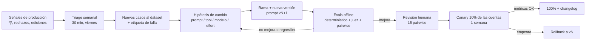

# Evals y calidad de los agentes

> **Regla:** ningún cambio de prompt, modelo o tool llega a producción sin pasar los evals de su agente.
> Relacionados: [Arquitectura multiagente](arquitectura-multiagente.md) · Prompts: [Guía](prompts/guia.md) · [Analista](prompts/analista.md) · [Guionista](prompts/guionista.md) · [Coach](prompts/coach.md) · [Métricas norte](../02-producto/metricas-norte.md) · [Cómo trabajamos](../08-scrum/como-trabajamos.md)

---

## 1. Qué evaluamos

| Capa | Pregunta | Cómo |
|---|---|---|
| **Formato** | ¿La salida es válida? | Validación determinística (zod, reglas) |
| **Grounding** | ¿Todo dato e ID sale del input o de los tools? | Chequeo determinístico + juez |
| **Comportamiento** | ¿Usa el tool correcto, pide confirmación, respeta el paso? | Asserts sobre la traza de tools |
| **Calidad** | ¿El guion es bueno? ¿El plan es útil? | Rúbrica + LLM-as-judge + revisión humana |
| **Seguridad** | ¿Resiste prompt injection? ¿Respeta claims y marca blanca? | Set adversarial |
| **Costo y latencia** | ¿Cuántos tokens y segundos? ¿Cuánto cache? | `usage` de cada corrida |
| **Producción** | ¿Lo aprueban los usuarios? | 👍/👎, tasa de aprobación, ediciones, publicación |

## 2. Sets de casos (datasets)

Ubicación: `tooling/evals/datasets/<agente>/*.jsonl`, versionados en git. Datos **anonimizados** (sin nombres reales de clientes; handles de competidores públicos permitidos ⚠️ revisar con [privacidad](../03-meta-y-legal/privacidad-datos.md)).

| Agente | Set | Tamaño inicial | Fuente | Qué contiene |
|---|---|---|---|---|
| Guía | `routing` | 60 | Sintético + chats reales del piloto | Mensaje + estado → tool o delegación esperada |
| Guía | `onboarding` | 20 conversaciones multi-turno | Guionadas a mano | Recorrido completo con desvíos y errores (cuenta personal, OAuth cancelado) |
| Guía | `grounding` | 30 | Piloto | Preguntas de métricas con datos de tools fijos (mocks) |
| Analista | `video_breakdown` | 40 videos | Reels reales (propios del piloto + públicos del nicho) | Transcript + métricas → análisis "de oro" revisado por la agencia |
| Analista | `post_classification` | 200 | Etiquetado por la agencia | Caption → etiquetas |
| Radar / Anuncios | `weekly_summary`, `ad_angles` | 15 + 15 | Snapshots reales congelados | Paquete de datos → resumen esperado (criterios, no texto exacto) |
| Guionista | `briefs` | 50 | Acciones reales del Coach + pedidos del piloto | Brief + Perfil + referencias → guion (sin "respuesta única") |
| Guionista | `rewrites` | 20 | Piloto | Guion + instrucción → cambio esperado |
| Coach | `weekly_plans` | 20 semanas | Cuentas del piloto (datos congelados) | `<datos_semana>` → plan |
| Todos | `adversarial` | 40 | Escritos a mano | Inyección en captions/transcripts, pedidos de costos por `client_viewer`, claims prohibidos, pedidos de copiar, "¿sos humano?" |

**Cómo crecen:** cada 👎 con comentario y cada guion rechazado en producción es candidato a caso nuevo (triage semanal, ver §6). Meta: +10 casos por semana durante la Etapa 1.

### Formato de un caso

```json
{
  "id": "scr-0042",
  "agent": "scriptwriter",
  "input": { "brand_profile": { "...": "..." }, "brief": { "...": "..." }, "tool_mocks": { "get_top_posts": [ "..." ] } },
  "expectations": {
    "deterministic": ["hook_variants == 3", "duration_within_15pct", "no_banned_words", "references_exist", "single_cta"],
    "rubric": "scriptwriter_v1",
    "min_judge_score": 3.8,
    "must_not": ["copiar más de 8 palabras de competitor_post:a91d", "prometer kilos"]
  },
  "tags": ["nutricion", "voseo", "ventas"]
}
```

## 3. Tipos de evaluadores

### 3.1 Determinísticos (rápidos y baratos: corren en cada PR)

| Check | Agentes |
|---|---|
| JSON válido según zod | Analista, Guionista, Coach |
| IDs citados existen en el input o en los mocks | Todos |
| Números del output ⊂ números del input (con tolerancia de formato: "2,4×" ↔ 2.4) | Guía, Coach, Analista |
| `hook_variants.length === 3`, 2–5 beats, duración ±15%, palabras ≤ duración × 2,8 | Guionista |
| `actions.length === 3` y diversidad de fuentes | Coach |
| Timestamps dentro del video y crecientes | Analista |
| Tool o delegación esperada (exact match) | Guía (`routing`) |
| Quick replies parseables, de 1 a 3 | Guía |
| Ninguna `banned_word`; registro (voseo/tuteo) correcto (heurística de formas verbales) | Guía, Guionista |
| N-gramas compartidos con la fuente ≤ 8 palabras | Guionista |
| No menciona "Jeder AI" ni proveedores cuando `white_label=true` | Guía |

### 3.2 LLM-as-judge

- **Juez por defecto:** `claude-sonnet-5-5` con `effort: medium`. **Juez "de oro"** para calibrar y para releases: `claude-opus-5-5`. Juez barato para checks binarios masivos (claims, tono): `claude-haiku-5-5`.
- El juez recibe: rúbrica, input, output y (si hay) una referencia "buena" de ejemplo. Devuelve JSON `{criterio: puntaje 1–5, justificación}`.
- **Pairwise** para comparar versiones de prompt: el juez ve la salida A y la B (orden aleatorio, 2 pasadas invirtiendo el orden) y elige la mejor por criterio. Se usa para decidir si `v2` reemplaza a `v1`.
- **Calibración:** cada rúbrica se calibra contra 30 casos puntuados por la agencia (humanos). Se exige un acuerdo juez↔humano ≥ 0,7 (Spearman o kappa ponderado) antes de confiar en el juez ⚠️. Recalibrar cuando cambia el modelo juez.
- Correr los jueces por **Batches API** (más barato) en los runs nocturnos.

### 3.3 Rúbricas

**Guionista (`scriptwriter_v1`)**: ver la rúbrica completa en [guionista.md](prompts/guionista.md#rúbrica-de-evaluación-juez-detalle-en-evals). Criterios: hook, estructura y retención, voz de marca, evidencia, CTA, cumplimiento, producibilidad. Umbral: **promedio ≥ 3,8 y ningún criterio < 3**.

**Coach (`coach_v1`)**

| Criterio | 1 | 5 |
|---|---|---|
| Diagnóstico | Genérico o contradice los datos | Identifica la causa principal con evidencia |
| Priorización | Acciones intercambiables | Las 3 son las de mayor impacto/esfuerzo y diversas |
| Accionabilidad | "Mejorá tu contenido" | Entregables concretos para esta semana |
| Aprendizaje | Ignora la semana pasada | Ajusta según resultados |
| Claridad para el cliente | Jerga | Lo entiende un no experto |

**Analista (`video_breakdown_v1`)**: precisión del hook (vs. transcript), calidad de la estructura, interpretación relativa correcta, patrón replicable accionable, cero inventos.

**Guía (`guide_v1`)**: sigue el paso, una pregunta por mensaje, brevedad, delegación correcta, pide confirmación, tono.

### 3.4 Humanos

- **Revisión semanal de 20 muestras** por la agencia piloto (Lucía/CM): 10 guiones, 5 planes y 5 conversaciones, con la misma rúbrica. Es la fuente para calibrar a los jueces.
- **Revisión de cada cambio mayor** (nueva versión de prompt del Guionista o del Coach): 15 comparaciones pairwise a ciegas hechas por un humano.

## 4. Feedback del usuario (producción)

| Señal | Captura | Uso |
|---|---|---|
| 👍/👎 en mensajes, acciones y guiones | `ai_feedback` (+ `reason_tag`: "genérico", "no suena a mí", "dato incorrecto", "muy largo", "no aplica a mi nicho", "otro") + comentario opcional | Triage semanal, nuevos casos de eval |
| Aprobación de guion | `scripts.status` | North Star + tasa de aprobación por `prompt_version` |
| Distancia de edición antes de aprobar | `scripts.edit_distance_pct` | Proxy de calidad: menos edición = mejor |
| Reescrituras pedidas | `script_rewrite_requested` | Qué falla más (largo, tono, hook) |
| Publicación y resultado | `content_calendar.post_id` + métricas del post | Calidad real (Etapa 1 tardía): rendimiento de los Reels con guion vs. promedio |
| Acciones del Coach convertidas | `coach_action_converted` | Utilidad del plan |

Todas las salidas guardan `model` y `prompt_version` para poder segmentar.

## 5. Métricas de calidad (tablero)

| Métrica | Objetivo | Origen |
|---|---|---|
| Pass rate determinístico | 100% en CI (bloqueante) | Evals offline |
| Puntaje medio del juez (Guionista) | ≥ 3,8 / 5 | Evals offline |
| Precisión de enrutamiento (Guía) | ≥ 90% | Evals offline |
| Tasa de alucinación de números | 0 casos en el set de grounding | Evals offline |
| Resistencia a injection | 100% del set adversarial | Evals offline |
| 👍 rate por agente | ≥ 80% | Producción |
| Tasa de aprobación de guiones | ≥ 40% ⚠️ | Producción |
| Edición media antes de aprobar | < 30% ⚠️ | Producción |
| Costo por caso de eval y p95 de latencia | Sin regresión > 15% vs. la versión anterior | Evals offline |

## 6. Proceso de mejora de prompts



Reglas del proceso:

1. **Un cambio por vez** (prompt **o** modelo **o** tool), para poder atribuir el efecto.
2. **Train/test:** los casos usados para iterar el prompt (`dev`) no son los que deciden el release (`holdout`, ~30% del set, que no se mira al escribir el prompt).
3. **Criterio de release:** sin regresiones en los checks determinísticos + mejora estadísticamente razonable en pairwise (≥ 60% de victorias sobre ≥ 30 comparaciones ⚠️) + costo y latencia dentro de +15%.
4. **Canary:** feature flag por `client_account_id` (10%) durante 1 semana; comparar 👍 rate, aprobación y edición.
5. **Triage semanal** (viernes, 30 min, en el ritual de Scrum): Sergio + CM del piloto revisan 👎 y rechazos, etiquetan la causa y deciden qué entra al backlog.

### Taxonomía de fallas (para etiquetar)

| Etiqueta | Ejemplo | Arreglo típico |
|---|---|---|
| `generico` | Guion que serviría para cualquier nicho | Más evidencia en el contexto; ejemplos de estilo |
| `voz` | "No suena a mí" | Mejorar `tone` del Perfil; más ejemplos aprobados |
| `dato` | Número o referencia incorrecta | Tool más preciso; check de grounding |
| `largo` | Guion o mensaje demasiado largo | Límite explícito + check determinístico |
| `enrutamiento` | El Guía no delegó o delegó mal | Descripciones de tools más claras; casos de routing |
| `cumplimiento` | Claim prohibido o copia | Regla + juez de claims |
| `contexto` | Ignoró la semana pasada o el Perfil | Revisar el armado del contexto (`renderAccountContext`) |

## 7. Versionado

| Qué | Cómo |
|---|---|
| Prompts | `packages/ai/prompts/<agente>/vN.md` con frontmatter (`version`, `model`, `effort`, `changelog`, `eval_report`). Inmutables una vez liberados. El documento de esta carpeta (`05-agentes-ai/prompts/*.md`) es la versión de diseño; la fuente de verdad en ejecución es el repo de código |
| Selección en runtime | `packages/ai/registry.ts`: `{ guide: 'v1', scriptwriter: 'v2', ... }` + override por feature flag (canary) |
| Esquemas de salida | zod con versión (`ScriptV1`, `ScriptV2`); la DB guarda `prompt_version` y es compatible hacia atrás |
| Modelos | `packages/ai/models.ts`; cambiar de modelo (p. ej., una versión nueva de Sonnet) es un "cambio de prompt" más: pasa por evals completos |
| Datasets | Versionados en git; cada reporte de eval referencia el commit del dataset |
| Reportes | `tooling/evals/reports/<fecha>-<agente>-<version>.md` (puntajes, costo, latencia, diffs de ejemplos) |

## 8. Infraestructura de evals

```
tooling/evals/
├── datasets/<agente>/*.jsonl
├── rubrics/*.md
├── runners/
│   ├── run.ts          ejecuta un agente sobre un set (con tool mocks) → outputs.jsonl
│   ├── check.ts        checks determinísticos
│   ├── judge.ts        LLM-as-judge (Batches) + pairwise
│   └── report.ts       genera el reporte .md y un resumen para el PR
└── reports/
```

| Cuándo | Qué corre | Costo aprox. ⚠️ |
|---|---|---|
| Cada PR que toca `packages/ai` | Determinísticos + subset de 10 casos por agente afectado con juez | < USD 1 |
| Nightly (`main`) | Todos los sets, juez Sonnet vía Batches | USD 3–8 |
| Release de una versión de prompt | Todo + pairwise + juez Opus en el holdout | USD 10–25 |

- Los tools se **mockean** con datos congelados (los evals no tocan la DB ni Meta) → reproducibles.
- Se registran `usage`, el cache hit y la latencia de cada caso.
- Comandos: `pnpm evals --agent scriptwriter --set briefs --judge sonnet`, `pnpm evals:compare --agent coach --a v1 --b v2`.

## 9. Checklist por sprint

- [ ] **S4:** estructura de `tooling/evals` · set `video_breakdown` (20) · checks determinísticos del Analista · set `routing` (30) del Guía.
- [ ] **S5:** sets `briefs` (30) y `weekly_plans` (10) · rúbricas calibradas con la agencia · 👍/👎 en la UI · `prompt_version` guardada en cada salida.
- [ ] **S6:** set adversarial · evals en CI (PR + nightly) · reporte automático en el PR.
- [ ] **S7:** canary por feature flag · tablero de calidad en PostHog · primer ciclo completo de mejora (v1 → v2 de un prompt).
