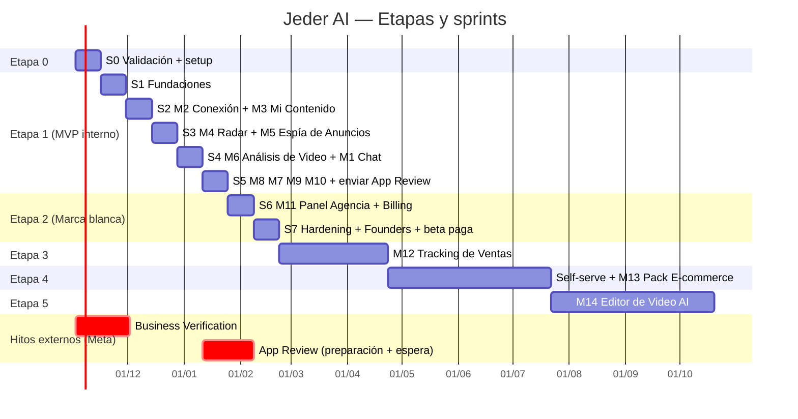

# Roadmap por Etapas — Jeder AI

> Fuente de verdad de etapas, sprints y módulos: el brief común. Este documento baja a tierra **qué** se entrega en cada etapa, **cuándo** se considera terminada y **qué** se puede hacer en paralelo.
> Módulos: ver [02-producto/modulos.md](../02-producto/modulos.md). Backlog detallado: [08-scrum/backlog.md](../08-scrum/backlog.md). Sprints: [08-scrum/sprints/](../08-scrum/sprints/).

## Resumen

| Etapa | Nombre | Cuándo | Sprints | Módulos | Meta principal |
|---|---|---|---|---|---|
| 0 | Validación + Piloto agencia | Semanas 1–2 | S0 | — (validación + setup) | 10 entrevistas, ≥3 agencias "sí, lo pagaría", piloto definido |
| 1 | MVP interno usado por la agencia | Semanas 3–12 | S1–S5 | M1–M10 (M9 simple) | La agencia de Jedertech lo usa cada semana con 3–5 clientes reales |
| 2 | Lanzamiento Marca Blanca + primeras ventas | Semanas 13–16 | S6–S7 | M11 + Billing + hardening | 5 agencias pagas (~USD 2,5–5k MRR) ⚠️ |
| 3 | Tracking de Ventas | Meses 5–6 | S8–S11 (aprox.) | M12 | 15 agencias (~USD 10k MRR) ⚠️ |
| 4 | Self-serve público final + Pack E-commerce | Meses 7–9 | S12–S17 (aprox.) | M13 + planes Solo/Pro | Primeros clientes self-serve; camino a USD 30k MRR ⚠️ |
| 5 | Editor de Video AI | Mes 10+ | S18+ | M14 | USD 30k MRR al mes 12 ⚠️ |

> ⚠️ A validar: todas las metas de ingresos son **objetivos**, no proyecciones con base estadística. Se recalibran al cerrar la Etapa 0 con los datos de las entrevistas.

## Diagrama de alto nivel

Fecha de inicio supuesta: lunes 2 de noviembre de 2026 ⚠️ (ajustar al día real de arranque). Ojo con fiestas de fin de año y vacaciones de enero en LATAM: caen dentro de S4–S5.

---

## Etapa 0 — Validación + Piloto agencia (Sprint 0, semanas 1–2)

**Objetivo:** confirmar que las agencias de infoproductores pagarían el precio canónico y dejar listo todo lo que tiene "tiempo de espera externo" (Meta, dominio, repo) antes de escribir producto.

**Módulos:** ninguno en producción. Se arma la base: repo, app de Meta, landing.

**Entregables**
- 10 entrevistas a agencias hechas y sintetizadas (guión en [01-comercial/](../01-comercial/)).
- Landing con waitlist publicada (dominio propio, formulario, píxel/PostHog).
- Piloto definido con la agencia de Jedertech: 3–5 cuentas cliente concretas, responsable, criterios de éxito.
- App de Meta en modo desarrollo creada; **Business Verification iniciada** (ver [03-meta-y-legal/meta-app-review-y-permisos.md](../03-meta-y-legal/meta-app-review-y-permisos.md)).
- Repo nuevo `jedertech-ai-platform` creado con `CLAUDE.md`, subagentes de desarrollo y GitHub Projects.
- Borradores de Política de Privacidad, TyC y flujo de borrado de datos.

**Criterio de salida (exit criteria)**
- [ ] ≥10 entrevistas registradas con notas en el repo/Drive.
- [ ] ≥3 agencias dicen explícitamente que pagarían ≥ USD 497/mes (o dejan seña / carta de intención) ⚠️.
- [ ] ≥30 registros en waitlist (orgánico + red de contactos) ⚠️.
- [ ] Business Verification enviada (no hace falta que esté aprobada).
- [ ] Repo con CI mínima en verde y board del Sprint 1 cargado.
- [ ] Decisión go/no-go firmada por el PO (si no hay señal de pago: ajustar ICP/precio y repetir validación 1 sprint más).

**Meta de métricas:** 10 entrevistas, ≥3 intenciones de compra, ≥30 waitlist.

**Riesgos**
| Riesgo | Mitigación |
|---|---|
| Las agencias dicen "me encanta" pero no pagan | Pedir compromiso concreto: seña, LOI, precio Founders con fecha |
| Business Verification demora o rebota | Iniciarla el día 1; tener documentos legales de la empresa listos |
| Sergio se va a programar antes de validar | Sprint 0 tiene metas comerciales explícitas; el PO las revisa |

**Duración:** 2 semanas.

---

## Etapa 1 — MVP interno usado por la agencia (Sprints 1–5, semanas 3–12)

**Objetivo:** construir M1–M10 y que el equipo de la agencia de Jedertech lo use de verdad con sus clientes, reemplazando trabajo manual (análisis de competencia, ideas de guiones, reportes).

**Módulos por sprint**
| Sprint | Módulos / foco |
|---|---|
| S1 | Fundaciones: monorepo, Next.js, Supabase Auth, multi-tenant + RLS, Drizzle, CI, deploy, UI base |
| S2 | M2 Conexión de Cuentas + M3 Mi Contenido |
| S3 | M4 Radar de Competencia + M5 Espía de Anuncios (scrapper como worker) |
| S4 | M6 Análisis de Video + M1 Onboarding Guiado (orquestador base) |
| S5 | M8 Guionista AI + M7 Coach AI + M9 Calendario (simple) + M10 Reportes + **envío de App Review** |

**Entregables**
- App web desplegada (Vercel) + worker (Railway/Fly.io) + Postgres Supabase con RLS por tenant.
- Agencia piloto usando el producto con 3–5 cuentas cliente reales (en modo desarrollo de Meta, con los clientes agregados como testers).
- Reporte semanal generado automáticamente para cada cuenta piloto.
- App Review enviada con screencasts de todos los permisos.

**Criterio de salida**
- [ ] Las 5 cuentas piloto conectadas y con datos actualizándose a diario sin intervención manual por 2 semanas.
- [ ] El equipo de la agencia usa el chat guía (M1) y el Guionista (M8) al menos 1 vez por semana por cuenta.
- [ ] ≥1 guion generado por la herramienta fue grabado y publicado por un cliente.
- [ ] Costo variable medido por cuenta ≤ USD 10 (techo USD 25)/mes (o plan concreto para llegar) ⚠️.
- [ ] Tests de aislamiento multi-tenant (RLS) en verde en CI.
- [ ] App Review enviada.

**Meta de métricas:** 5 cuentas activas, ≥70% de uso semanal del equipo piloto, NPS interno ≥ 8 ⚠️.

**Riesgos**
| Riesgo | Mitigación |
|---|---|
| Alcance demasiado grande para 1 dev + Claude | Velocidad medida desde S1; recortar a "versión simple" (M9, M10) antes que atrasar |
| Meta cambia la Biblioteca de Anuncios y se rompe el scrapper | Circuit breaker existente, alertas, proveedor de respaldo (Apify) en backlog, el valor no depende solo de M5 |
| Costos de LLM/transcripción se disparan | Haiku para clasificación, prompt caching, cache por hash de video, límites por cuenta |
| Fiestas/vacaciones (dic–ene) | Planificar capacidad reducida en S4–S5 |
| App Review rechazada | Preparar screencasts desde S2 (JA-029), checklist del doc de Meta |

**Duración:** 10 semanas.

---

## Etapa 2 — Lanzamiento Marca Blanca + primeras ventas (Sprints 6–7, semanas 13–16)

**Objetivo:** convertir el MVP interno en un producto que otra agencia pueda usar con su marca y pagar sin hablar con Sergio.

**Módulos:** M11 Panel de Agencia (dominio custom, logo, colores, subcuentas) + Billing (Stripe, MercadoPago opcional) + hardening, seguridad, observabilidad.

**Entregables**
- Agencia nueva puede: pagar (Agency Starter/Pro/Scale + setup), configurar su marca y dominio, crear cuentas cliente, invitar a su equipo.
- Oferta Founders (−40% de por vida, primeras 10 agencias) operativa.
- Playbook de onboarding de agencias, página de precios, demo grabada, caso del piloto.
- Alertas, backups probados, revisión de seguridad hecha.

**Criterio de salida**
- [ ] **5 agencias pagando** (≈ USD 2,5–5k MRR con descuento Founders) ⚠️.
- [ ] Al menos 1 agencia operando con dominio propio y su logo.
- [ ] App Review aprobada (Advanced Access) **o** plan B acordado con el PO si sigue en revisión (los clientes como testers de la app).
- [ ] 0 incidentes de fuga de datos entre tenants; revisión de seguridad sin hallazgos críticos abiertos.
- [ ] Churn 0 en el primer mes de las Founders.

**Riesgos**
| Riesgo | Mitigación |
|---|---|
| App Review no aprobada a tiempo | Modo desarrollo con clientes agregados como testers (límite de usuarios ⚠️); vender igual con M4/M5/M6/M8 que no dependen de permisos del cliente |
| Ventas: nadie dedicado a vender | Definir responsable comercial en Etapa 0 (ver [10-preguntas-abiertas.md](../10-preguntas-abiertas.md)) |
| Dominio custom complejo (SSL, DNS) | Usar API de dominios de Vercel; fallback a subdominio `agencia.jederai.app` ⚠️ |
| Fricción de pago en LATAM | Stripe + MercadoPago si las entrevistas lo piden |

**Duración:** 4 semanas.

---

## Etapa 3 — Tracking de Ventas M12 (meses 5–6)

**Objetivo:** conectar contenido/anuncios con ventas reales (Hotmart, Kiwify, Eduzz, Stripe, etc.) para que el Coach recomiende en base a facturación, no solo a likes. Ver [06-tracking/tracking-infoproductores.md](../06-tracking/tracking-infoproductores.md).

**Módulos:** M12 + Agente de Tracking.

**Entregables:** integraciones con 2–3 plataformas de venta vía webhooks, UTMs/links trackeados por pieza de contenido, atribución simple (último clic + ventana), dashboard de ventas por contenido/anuncio, el Coach usa ventas como señal.

**Criterio de salida**
- [ ] ≥5 cuentas con ventas conectadas y conciliadas (±5% vs. la plataforma) ⚠️.
- [ ] Recomendaciones del Coach citan ventas atribuidas.
- [ ] 15 agencias pagas (~USD 10k MRR) ⚠️.

**Riesgos:** atribución imprecisa (iOS, cross-device), APIs de plataformas de venta cambiantes, privacidad de datos de compradores (minimizar PII, hash de emails).

**Duración:** ~8 semanas (4 sprints).

---

## Etapa 4 — Self-serve público final + Pack E-commerce M13 (meses 7–9)

**Objetivo:** abrir venta directa a infoproductores (planes Solo USD 297 / Pro USD 497) con onboarding 100% por chat, y extender a e-commerce (catálogo, Shopify/Tiendanube, análisis de anuncios de producto).

**Módulos:** M13 + planes público final + funnel de adquisición.

**Entregables:** registro + trial/demo, onboarding guiado sin humano, planes anuales (2 meses gratis), integración Shopify/Tiendanube, plantillas de guion para producto físico.

**Criterio de salida**
- [ ] Conversión registro→pago ≥ 5% ⚠️; activación (primer análisis en <15 min) ≥ 60% ⚠️.
- [ ] ≥20 clientes self-serve pagos ⚠️.
- [ ] Camino creíble a USD 30k MRR al mes 12.

**Riesgos:** canibalizar a las agencias (mitigar: precio público ≥ precio de reventa sugerido; agencias suman servicio), CAC alto sin contenido propio, soporte sin equipo.

**Duración:** ~12 semanas.

---

## Etapa 5 — Editor de Video AI M14 (mes 10+)

**Objetivo:** cerrar el ciclo: del guion al video editado (cortes, subtítulos, b-roll, hooks alternativos), comoditizando la edición que hoy hace la agencia.

**Módulos:** M14.

**Entregables:** subtítulos automáticos con estilo de marca, recorte de silencios, variantes de hook, export vertical 9:16, cola de render.

**Criterio de salida:** ≥30% de las cuentas activas exportan ≥1 video/semana ⚠️; costo de render por video dentro de margen > 80%.

**Riesgos:** costo de cómputo (GPU/render), competencia fuerte (CapCut, Opus Clip, etc.), calidad percibida. Evaluar "comprar vs. construir" (APIs de terceros) antes de arrancar.

**Duración:** abierta (mes 10+).

---

## Qué se puede hacer en paralelo

| Carril | Quién | Qué corre en paralelo al desarrollo |
|---|---|---|
| Meta (externo) | PO + Sergio | Business Verification (S0→), screencasts por permiso (S2→), App Review (S5→S7) |
| Comercial | PO / responsable de ventas | Entrevistas (S0), waitlist y contenido (S0→), preventa Founders (S4→), onboarding agencias (S6→) |
| Legal | PO + asesor | TyC, Privacidad, data deletion (S0→S5), DPA para agencias (S6–S7), dictamen sobre scraping (S0–S3) |
| Desarrollo — dentro de un sprint | Sergio + Claude (subagentes) | Backend y frontend del mismo módulo en ramas separadas; worker de scraping (M5) independiente de M4; transcripción (M6) independiente del chat (M1) |
| Producto/AI | Sergio + Claude | Prompts y evals de agentes del producto (ver [05-agentes-ai/arquitectura-multiagente.md](../05-agentes-ai/arquitectura-multiagente.md)) mientras se construye la UI |

**Dependencias duras (no paralelizables)**
- Fundaciones (S1: auth, multi-tenant, RLS) → todo lo demás.
- M2 Conexión → M3 Mi Contenido → M7 Coach (necesita datos propios).
- M4/M5/M6 → M8 Guionista (necesita referencias ganadoras).
- App Review aprobada → venta abierta a agencias sin límite de testers.
- M11 + Billing → Etapa 2.
