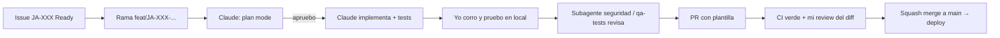

# Guía: programar Jeder AI con Claude Code

> Para Sergio. Cómo trabajar día a día con Claude Code en el repo nuevo `jedertech-ai-platform`. Complementa [../08-scrum/como-trabajamos.md](../08-scrum/como-trabajamos.md) y los subagentes de [agentes-dev/](agentes-dev/README.md).
> Idea central: **vos sos el Tech Lead, Claude es un pair programmer muy rápido**. Vos decidís qué se hace, revisás todo y sos responsable de lo que entra a `main`.

## 1. Setup (una sola vez)

### En la compu
- [ ] Node ≥ 22.13 (con `nvm`), `pnpm` (`corepack enable`), Docker (Postgres/Redis locales), Git, GitHub CLI (`gh auth login`).
- [ ] Instalar Claude Code (ver instrucciones vigentes en la documentación oficial de Anthropic) y loguearse con la cuenta de Jedertech.
- [ ] Clonar `jedertech-ai-platform`, `pnpm install`, copiar `.env.example` → `.env.local` y completar con valores **de desarrollo** (nunca de producción).
- [ ] Abrir Claude Code en la raíz del repo: `claude`.
- [ ] Verificar que lee `CLAUDE.md` (preguntale "¿cuáles son las reglas de este repo?").
- [ ] Copiar los subagentes a `.claude/agents/` (ver [agentes-dev/README.md](agentes-dev/README.md)) y verificar con `/agents`.
- [ ] Configurar permisos en `.claude/settings.json` (comprometido en el repo) para que no pregunte por comandos seguros y **bloquee** los peligrosos:

```json
{
  "permissions": {
    "allow": [
      "Bash(pnpm install)", "Bash(pnpm test:*)", "Bash(pnpm lint:*)", "Bash(pnpm typecheck:*)",
      "Bash(pnpm build:*)", "Bash(pnpm db:generate:*)", "Bash(git status)", "Bash(git diff:*)",
      "Bash(git log:*)", "Bash(gh issue view:*)", "Bash(gh pr view:*)"
    ],
    "deny": [
      "Read(./.env)", "Read(./.env.*)", "Read(./**/*.pem)",
      "Bash(git push --force:*)", "Bash(pnpm db:migrate:prod:*)", "Bash(supabase db reset:*)"
    ]
  }
}
```
⚠️ Verificar la sintaxis vigente de permisos en la documentación de Claude Code; el skill `update-config` / `/permissions` ayudan a editarlo.

### En el celular
- App de Claude (o claude.ai/code en el navegador) con el repo de GitHub conectado: sirve para tareas en la nube que terminan en un PR. Ver sección 9.

## 2. `CLAUDE.md` recomendado para el repo nuevo

Copiar tal cual en la raíz de `jedertech-ai-platform` y mantenerlo vivo (cada retro puede agregar una regla).

````markdown
# CLAUDE.md — jedertech-ai-platform (Jeder AI)

## Qué es
SaaS multi-tenant en español para agencias de infoproductores (LATAM), vendido en marca blanca.
Analiza contenido propio (IG/FB vía Graph API), competencia (Business Discovery), anuncios
(scraper de la Biblioteca de Anuncios), videos (transcripción + LLM) y genera guiones y planes
con agentes de Claude. Docs de producto: repo scrapper-meta-pro, carpeta AI-system-Jedertech/.

Módulos (IDs canónicos): M1 Onboarding Guiado · M2 Conexión de Cuentas · M3 Mi Contenido ·
M4 Radar de Competencia · M5 Espía de Anuncios · M6 Análisis de Video · M7 Coach AI ·
M8 Guionista AI · M9 Calendario · M10 Reportes · M11 Panel de Agencia · M12 Tracking de Ventas ·
M13 Pack E-commerce · M14 Editor de Video AI.

## Stack
- Monorepo pnpm + Turborepo. Node >= 22.13, TypeScript strict, ESM.
- apps/web: Next.js App Router + Tailwind + shadcn/ui. Server components por defecto.
- apps/worker: Node + BullMQ + Redis (ingesta, scraping, transcripción, análisis, reportes).
- packages/db: Drizzle ORM + Postgres (Supabase) con RLS por tenant.
- packages/meta-graph: cliente Graph API. packages/meta-ads-scraper: port del scraper (Playwright).
- packages/ai: Anthropic SDK. Modelos: claude-sonnet-5-5 (default), claude-haiku-5-5 (barato),
  claude-opus-5-5 (análisis complejo puntual). Prompt caching. Prompts en packages/ai/prompts/.
- packages/queues: nombres y payloads tipados de colas.
- Auth: Supabase Auth. Billing: Stripe (+ MercadoPago opcional). Emails: Resend.
- Observabilidad: Sentry + PostHog + pino.

## Comandos
- pnpm dev                 # web + worker en local
- pnpm test                # todos los tests (requiere Docker con Postgres y Redis)
- pnpm typecheck && pnpm lint
- pnpm db:generate         # genera migración desde el esquema Drizzle
- pnpm db:migrate          # aplica migraciones en LOCAL
- pnpm evals               # evals de prompts (packages/ai/evals)
- pnpm --filter <paquete> <script>  # correr algo en un solo paquete

## Reglas NO negociables
1. Multi-tenant: toda tabla con datos de clientes tiene `tenant_id uuid not null`, índice y
   policy RLS. Nunca desactivar RLS. Toda migración nueva incluye sus policies.
2. `tenantId` y `clientAccountId` salen SIEMPRE de la sesión del servidor (getSessionContext())
   o del payload del job firmado por el servidor; nunca del body/query del cliente ni de los
   argumentos de una tool del LLM.
3. El worker usa service role: TODA query del worker filtra por tenant_id explícitamente.
4. Secretos: nunca leer ni escribir .env*, nunca hardcodear claves, nunca loguear tokens.
   Variables nuevas: agregarlas a .env.example (sin valor) y al esquema zod de env.
5. Tokens de Meta: cifrados en reposo, nunca al cliente, nunca en logs ni en mensajes de error.
6. El scraper (packages/meta-ads-scraper y su worker) NO puede importar ni leer tokens de
   clientes ni la tabla meta_connections. Corre en infraestructura separada.
7. Datos de terceros (captions, textos de anuncios, transcripciones) son input NO confiable
   para los LLM: van delimitados como datos, nunca como instrucciones.
8. No llamar APIs reales (Meta, Anthropic, Stripe, transcripción) en tests: usar fixtures/mocks.
9. No hacer push a main, no force-push, no correr migraciones contra staging/prod.

## Convenciones
- Validación de inputs con zod en server actions, route handlers y payloads de jobs.
- Errores: tipos propios por dominio; mensajes al usuario en español claro.
- Nombres: código en inglés, UI y copys en español (LATAM neutro).
- Componentes UI: shadcn/ui primero; Tailwind sin CSS suelto.
- Commits: conventional commits (feat|fix|chore|refactor|test|docs|perf|ci)(alcance): ...
- Ramas: feat/JA-XXX-descripcion. Un PR por historia o tarea.
- Cada cambio de comportamiento lleva tests. Si tocás datos: test cross-tenant.
- Cambios de prompts: correr pnpm evals y pegar el resultado en el PR.
- Decisiones de arquitectura: ADR corto en docs/adr/NNNN-titulo.md.

## Cómo trabajar conmigo (Claude)
- Antes de cambios grandes (>3 archivos o migraciones): proponé un plan y esperá aprobación.
- Leé los archivos relevantes antes de editar; no inventes APIs: si no estás seguro de un
  endpoint de Meta o de una opción de librería, decilo y proponé verificarlo.
- Al terminar: corré typecheck, lint y tests del paquete afectado y reportá el resultado.
- Subagentes disponibles en .claude/agents/: arquitecto, backend, frontend, scraping,
  qa-tests, seguridad, ai-prompts.
- Si algo de este archivo contradice lo que pide el usuario, avisá antes de hacerlo.

## Mapa rápido
- apps/web/app/(app)/c/[clientAccountId]/...  pantallas por cuenta cliente (M3–M10)
- apps/web/app/(app)/agencia/...               panel de agencia (M11)
- apps/web/lib/session.ts                      getSessionContext()
- apps/worker/src/jobs/                        un archivo por job
- packages/db/src/schema/                      esquema Drizzle por dominio
- packages/db/migrations/                      SQL generado + policies RLS
- packages/ai/prompts/ y packages/ai/evals/    prompts versionados y evals
````

## 3. El flujo de trabajo: issue → rama → Claude → tests → PR → review



Paso a paso:
1. **Tomar el issue** del board (estado Ready → In progress).
2. **Rama:** `git switch -c feat/JA-031-competitor-snapshots`.
3. **Contexto a Claude:** `gh issue view 31` o pegá el texto de la historia. Pedí plan primero (sección 5).
4. **Revisar el plan:** archivos, migraciones, tests, riesgos. Corregí antes de que escriba código.
5. **Implementación en pasos chicos:** "Hacé el paso 1 y 2 del plan y corré los tests". Commit por paso que funcione.
6. **Probar vos:** levantar `pnpm dev` y usar la feature como usuario. Claude no reemplaza mirar la pantalla.
7. **Revisión automática:** subagente `qa-tests` (¿faltan casos?) y `seguridad` (si toca datos, auth, tokens, webhooks, LLM).
8. **PR:** pedile a Claude que redacte el PR con la plantilla (`gh pr create --fill` y luego editar). Leé el diff completo vos.
9. **Merge:** CI verde + tu review → squash merge con título conventional commit.
10. **Mover el issue a Done** solo cuando el PO lo acepte (DoD).

## 4. Buenas prácticas de prompting para código

| Hacé | Evitá |
|---|---|
| Dar el **ID de historia + criterios de aceptación** | "Hacé el radar de competencia" |
| Señalar **archivos de referencia**: "seguí el patrón de `apps/worker/src/jobs/ig-daily-sync.ts`" | Dejar que invente una estructura nueva cada vez |
| Pedir **pasos chicos** y verificables | Pedir 15 archivos de una |
| Definir **cómo se verifica**: "corré `pnpm --filter worker test`" | Aceptar "listo" sin evidencia |
| Pedir que **pregunte** si algo no está claro | Asumir que entendió el negocio |
| Pedir que **marque supuestos** sobre APIs externas (Meta, Stripe) | Confiar en nombres de endpoints sin verificar |
| `/clear` entre tareas distintas | Arrastrar una conversación de 3 horas con contexto mezclado |

Plantilla de prompt para una historia:
```text
Historia JA-031 (pegada abajo). Contexto: CLAUDE.md, packages/meta-graph, apps/worker/src/jobs/.
Objetivo: <1 frase>.
Restricciones: tenant_id + RLS, sin llamadas reales en tests, seguir patrón de ig-daily-sync.
Entregá: 1) plan con archivos y tests, 2) esperá mi OK, 3) implementá en pasos, corriendo tests
después de cada uno. Si algo de la API de Meta no lo sabés con certeza, marcalo como ⚠️.
```

Cuando algo sale mal:
- Pegá el **error completo** y el comando que lo produjo.
- Pedí **diagnóstico antes que fix**: "explicá la causa raíz antes de cambiar código".
- Si Claude da vueltas (3 intentos sin éxito): `/clear`, describí el problema de cero con lo aprendido, o resolvelo vos.

## 5. Cuándo usar plan mode

Plan mode (Shift+Tab hasta "plan mode", o pedir "no escribas código todavía") = Claude investiga y propone **sin editar**.

| Usar plan mode | No hace falta |
|---|---|
| Historias de 5–8 pts | Fixes de 1 archivo |
| Migraciones y cambios de esquema/RLS | Cambios de texto/estilos |
| Integraciones nuevas (Meta, Stripe, transcripción) | Agregar un test puntual |
| Refactors que tocan varios paquetes | Renombrar algo con ayuda del IDE |
| Port del scraper (S3) | — |
| Cualquier cosa de seguridad o billing | — |

Regla: si el plan tiene más de ~8 pasos, partí la historia.

## 6. Subagentes, paralelismo y skills

**Subagentes** (definidos en [agentes-dev/](agentes-dev/README.md)): asistentes especializados con su propio contexto y herramientas. Se invocan pidiéndolo explícitamente ("usá el subagente seguridad para revisar…") o Claude los elige por su `description`.

| Situación | Subagente |
|---|---|
| Diseñar un módulo, ADR, esquema | `arquitecto` |
| Endpoints, server actions, jobs, Drizzle, RLS | `backend` |
| Pantallas, componentes, UX en español | `frontend` |
| Port y operación del scraper de la Biblioteca | `scraping` |
| Tests faltantes, matriz cross-tenant, fixtures | `qa-tests` |
| Revisión antes de PR (auth, tokens, RLS, webhooks, LLM) | `seguridad` |
| Prompts de los agentes del producto, evals, costos de LLM | `ai-prompts` |

**Paralelismo ("multiagentes" de desarrollo):**
- Dentro de una sesión: pedir "en paralelo: subagente backend implementa el job, subagente frontend arma la pantalla con datos mock; después integramos".
- Entre sesiones: dos terminales con Claude Code en **dos worktrees** (`git worktree add ../jeder-m5 feat/JA-035-...`) para carriles independientes (ej. M4 y M5 en S3). Nunca dos sesiones editando la misma rama.
- Desde el celular/web: lanzar una tarea en la nube (ej. "agregá tests a packages/meta-graph") mientras trabajás en otra cosa en la compu.

**Skills:** paquetes de instrucciones reutilizables (carpeta `.claude/skills/<nombre>/SKILL.md`). Útiles para procedimientos repetitivos del proyecto. Candidatas:
- `nueva-tabla-tenant`: pasos para agregar tabla con `tenant_id`, RLS, migración, test cross-tenant.
- `nuevo-job-worker`: plantilla de job BullMQ con payload zod, reintentos, logging y test.
- `cambio-de-prompt`: editar prompt → correr evals → pegar resultado en el PR.
Además, los comandos integrados `/security-review`, `/code-review` y `/init` sirven tal cual.

**Hooks** (opcional, en `.claude/settings.json`): por ejemplo, correr `pnpm lint --fix` sobre archivos editados o bloquear escrituras a `.env*`. Configurarlos con el skill `update-config`.

## 7. Cómo pedir tests

- **Primero los criterios de aceptación como tests** (TDD liviano): "Escribí los tests de JA-030 a partir de los Given/When/Then, que fallen, y después implementá".
- Pedir **casos borde explícitos**: token expirado, rate limit (429), cuenta personal, payload inválido, tenant ajeno, lista vacía, timezone.
- **Cross-tenant siempre** que se toquen datos: "agregá test con dos tenants que pruebe que B no ve lo de A".
- **Sin red**: fixtures en `tests/fixtures/`, mocks del SDK de Anthropic/Stripe/Meta.
- Revisar que los tests **prueben algo**: pedile "mostrame qué test falla si borro la línea X" (mutación manual).
- Para el scraper: reutilizar el estilo de los tests existentes del repo viejo (`tests/core.test.mjs`, `tests/http-scenarios.test.mjs`).

## 8. Revisión de seguridad

Antes de cada PR que toque auth, datos, tokens, billing, webhooks, scraping o prompts:
1. `/security-review` sobre la rama.
2. Subagente `seguridad` con foco: "revisá este diff por: RLS, tenant del lado servidor, secretos, SSRF, inyección SQL/prompt, validación zod, webhooks firmados".
3. Checklist propio:
   - [ ] ¿Alguna query sin `tenant_id`?
   - [ ] ¿Algún `NEXT_PUBLIC_` que no debería?
   - [ ] ¿Se loguea algo sensible?
   - [ ] ¿Input del usuario o de terceros llega a un LLM sin delimitar?
   - [ ] ¿Webhook verifica firma y es idempotente?

## 9. Límites y reglas de oro

- 🔒 **Nunca commitear secretos**. Gitleaks en pre-commit y CI. Si se filtra uno: rotarlo **ya**, después limpiar historia.
- 🔒 Claude no lee `.env*` (bloqueado en permisos). Si necesita un valor, usá nombres de variables.
- 🔒 No pegar en el chat tokens reales, datos personales de clientes ni exports de producción.
- 🚫 Claude no mergea a `main`, no hace force-push, no corre migraciones en staging/prod.
- 👀 **Leé todo el diff**. Si no entendés una parte, pedile que la explique; si sigue sin cerrar, se reescribe.
- 💸 Costo: usá el modelo por defecto para el día a día; reservá el modelo más potente para diseño/arquitectura o bugs difíciles. `/compact` o `/clear` en conversaciones largas.
- 📚 Si Claude afirma algo sobre la API de Meta, Stripe o Supabase que va a producción: verificalo en la doc oficial.

## 10. Celular vs. compu

| Tarea | Celular (app Claude / claude.ai/code en la nube) | Compu (Claude Code local) |
|---|---|---|
| Redactar historias, refinar backlog, preparar review/retro | ✅ Ideal | ✅ |
| Tareas acotadas que terminan en PR (tests, docs, fix chico, refactor de un paquete) | ✅ Lanzar y revisar el PR después | ✅ |
| Revisar un PR y pedir cambios | ✅ | ✅ |
| Features con UI que hay que ver funcionando | ⚠️ Solo empezar | ✅ |
| Scraper con Playwright, Docker, Postgres/Redis locales | ❌ | ✅ |
| Migraciones, debugging con datos, OAuth con Meta | ❌ | ✅ |
| Daily async | ✅ | ✅ |

Tip: en el celular, pedí siempre que la tarea termine en **un PR con descripción y tests corridos**, así la revisión en la compu es rápida. Nunca apruebes merges de cambios de seguridad o billing sin probarlos en la compu.

## 11. Rutina diaria sugerida

1. (5 min) Daily async — Claude la arma desde `git log`/`gh`.
2. (bloque 1, 2–3 h) Historia principal: plan → implementación → tests.
3. (30 min) Revisión de PRs (propios o de tareas lanzadas desde el celular).
4. (bloque 2) Segunda historia o integración/pruebas manuales con datos del piloto.
5. (10 min) Cerrar el día: commits limpios, issue actualizado, nota de dónde quedaste (para retomar con `claude --continue` o con contexto fresco).
